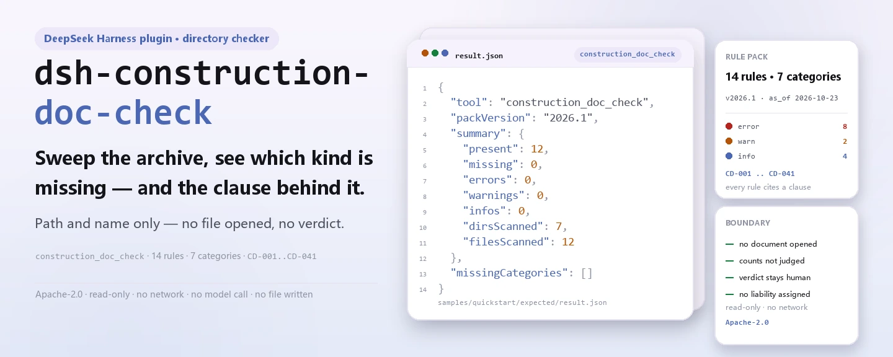
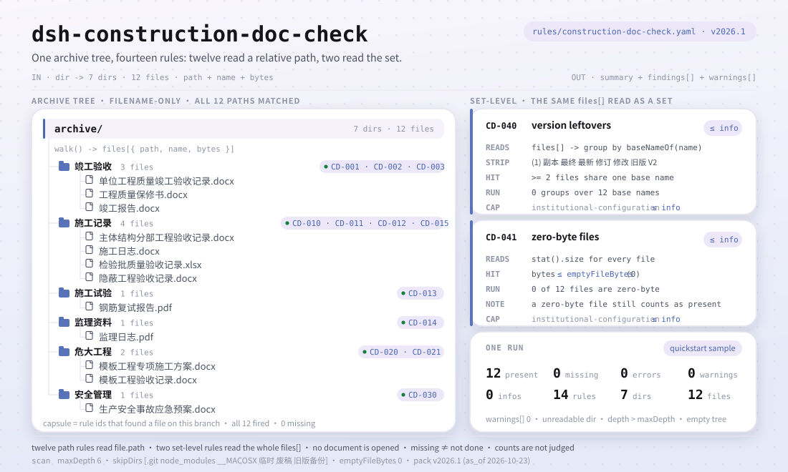

<div align="center">

<picture>
  <source media="(prefers-color-scheme: dark)" srcset="docs/assets/dsh-construction-doc-check-hero-en-dark.webp">
  
</picture>

# dsh-construction-doc-check

**Sweep a construction document archive and get the list of which required document is missing and which clause requires it — the verdict stays with the document controller and the supervisor.**

A folder-level checker plugin for DeepSeek Harness: it verifies 12 required document kinds against the relative path and file name, adds two set-level checks (revision leftovers, zero-byte files), and lists only the differences it can point to inside the archive — it never opens a document, judges compliance, or assigns liability.

[Install](#three-step-setup) · [Configuration](#configuration) · [FAQ](#faq) · [简体中文](README.md) · [English](README.en.md) · [Español](README.es.md) · [Português](README.pt.md) · [हिन्दी](README.hi.md)

[](LICENSE)
[](#compatibility)
[](https://www.npmjs.com/package/dsh-construction-doc-check)
[](https://github.com/PerryLink/dsh-construction-doc-check/actions/workflows/ci.yml)
[](#compatibility)

[](https://github.com/PerryLink/dsh-construction-doc-check/stargazers)
[](https://www.npmjs.com/package/dsh-construction-doc-check)
[](https://dshfind.com/plugins/PerryLink/dsh-construction-doc-check?ref=badge)
[](https://securityscorecards.dev/viewer/?uri=github.com/PerryLink/dsh-construction-doc-check)
[](https://gitee.com/perrylink/dsh-construction-doc-check)

```sh
dsh plugin --profile <name> add dsh-construction-doc-check
```

</div>

<sub>Community plugin, not affiliated with DeepSeek. Canonical repository: <https://github.com/PerryLink/dsh-construction-doc-check> (Gitee is a mirror).</sub>

## What it is

`dsh-construction-doc-check` scans a construction project's document archive and checks, by relative path and file name, whether each document kind the rule pack lists is present: which kind is missing, which clause requires it, and which file in the archive counts. It also reports two set-level problems: a document name appearing more than once (possible leftover revisions), and zero-byte files ("present but unusable").

It reads file names, not files. That is a deliberate ceiling: a real archive holds a thousand documents, and asking a document controller to transcribe them into a table first gives the controller more work, not less. The folder and the file names are what the controller already has.

- **Who it is for**: construction document controllers, supervisors, and owner-side document management; hand it a folder in chat.
- **What you give it**: the path of a construction project document folder (file names and directory structure only, never file contents).
- **What you get back**: a Markdown missing-document list (rule id, category, clause basis) plus a structured `resultJson`; every check that could not run says why in the warnings.

It answers four questions:

- Which required document kinds cannot be found anywhere in the archive?
- Which documents exist in more than one revision side by side?
- Which files are zero bytes, and therefore present but unusable?
- Which named requirement is missing, and which clause requires it?

**Boundary:** three claims this tool does not make. It does not open a document, so "present" is not "correct" — content is a later layer (L1/L2). It does **not** judge **how many** copies of a kind should exist: one subitem can need dozens of inspection-batch records, and this checks existence, not sufficiency. And a missing file means the archive cannot prove the work was done, which is not the same as the work not being done.

<picture>
  <source media="(prefers-color-scheme: dark)" srcset="docs/assets/dsh-construction-doc-check-flow-v5-dark.svg">
  
</picture>

## Three-step setup

1. **Install** (pick one channel):

   ```sh
   # git channel (latest main; equivalent to git+https://github.com/PerryLink/dsh-construction-doc-check.git)
   dsh plugin --profile <name> add github:PerryLink/dsh-construction-doc-check
   # npm channel (published releases)
   dsh plugin --profile <name> add dsh-construction-doc-check
   # tarball channel: pnpm pack in this repo, then
   dsh plugin --profile <name> add ./dsh-construction-doc-check-<version>.tgz
   ```

2. **Minimal config** (sane defaults; a bundle row without `config` uses every default, with the rule-pack path pointing at the bundled `rules/construction-doc-check.yaml`):

   ```yaml
   - insert:
       - id: dsh-construction-doc-check
         name: dsh-construction-doc-check
   ```

3. **Verify it mounts**: build first (`main` resolves to `lib/index.mjs`; the repository does not commit build output), then run the bundled sample:

   ```sh
   dsh --profile <name> --dump-config | grep 'dsh-construction-doc-check'
   pnpm install && pnpm run build
   node samples/quickstart/run.mjs --check
   # construction_doc_check: quickstart OK — output matches expected/result.json
   ```

   Sample output (matching `samples/quickstart/expected/result.json`):

   ```text
   construction_doc_check: 12 present, 0 missing — 0 error, 0 warn, 0 info (12 files, 7 dirs)
   ```

**Uninstall**: `dsh plugin --profile <name> remove dsh-construction-doc-check` (or remove the row from the profile patch).

## Core capabilities

`dsh-construction-doc-check` registers the `construction_doc_check` tool: pass it a document archive directory, it applies the versioned rule pack it ships, and returns a report.

- **14 rules in one data pack** — the rule pack is data, not code (`rules/construction-doc-check.yaml`, version `2026.1`, as of `2026-10-23`); replacing it switches the whole rule set without touching a line of TypeScript.
- **Matches the relative path, folders count** — real archives classify by folder (a model-form acceptance record kept under the danger-prone-works folder, for instance), so the match runs against the relative path, not just the file name.
- **Two set-level checks** — `CD-040` reports a document name appearing more than once in the archive (copy markers such as `(1)`, `V2`, or a local-language suffix for copy, final, latest, revised, or old version), and `CD-041` reports zero-byte files.
- **A zero-byte file still counts as present** — a missing document and an unusable one are reported separately: "there is a file" and "the file is usable" are two different statements, and the report makes both.
- **No fabricated citations** — every rule carries `document` / `number` / `clause` / `excerpt` / `kind` / `source`; `excerpt` must be a verbatim quotation, and `check:citations` verifies each one against `rules/evidence/clauses.md`.
- **Severity follows the evidence** — `derived-from-principle` is capped at `warn` (`CD-014`), `institutional-configuration` at `info` (`CD-015`, `CD-030`, `CD-040`, `CD-041`), and a test asserts it.
- **Read-only, no network, no model call** — pure ESM: directory walks, file-name regexes, and file-size reads; tool parameters are `dir` / `rulePackFile` / `maxDepth`.
- **The scan is never silent** — unreadable directories, depth-cap hits, and an empty folder all land in `warnings`; the report states its scope before its conclusions.

### Example

The expected output for the bundled sample (summarised by `samples/quickstart/run.mjs`, matching `samples/quickstart/expected/result.json`):

```json
{
  "tool": "construction_doc_check",
  "packVersion": "2026.1",
  "summary": {
    "present": 12,
    "missing": 0,
    "errors": 0,
    "warnings": 0,
    "infos": 0,
    "dirsScanned": 7,
    "filesScanned": 12
  },
  "missingCategories": []
}
```

*Observed from `samples/quickstart/expected/result.json`*

## Standards it follows

| Document | Number | Cited by rules |
|---|---|---|
| Unified Standard for Constructional Quality Acceptance of Building Engineering | GB 50300-2013 | CD-001, CD-010, CD-011, CD-012 |
| Regulation on the Quality Management of Construction Projects | State Council Decree No. 279 | CD-002, CD-003, CD-013 |
| Provisions on the Safety Management of Danger-Prone Sub-projects | Ministry of Housing and Urban-Rural Development Decree No. 37 | CD-020, CD-021 |
| Measures for the Administration of On-site Supervision of Building Construction (trial) | Jian Shi [2002] No. 189 | CD-014 |
| Institutional document filing policy (institutional configuration) | No unified standard | CD-015, CD-030, CD-040, CD-041 |

**Boundary:** this plugin checks the completeness of a **construction document archive** — whether each required document kind can be found by relative path, whether a document name appears more than once (possible leftover revisions), and whether any file is zero bytes. It does **not** open files, check contents, judge whether a form is correctly filled in, judge whether the count is sufficient, or assign liability. A missing document only means the archive cannot prove it, not that the work was not done.

> **`excerpt` status is per rule, not uniform.** Nine rules quote the clause verbatim (`kind: direct`); `CD-014` is derived from the principle of the cited articles (`kind: derived-from-principle`, capped at `warn`); `CD-015`, `CD-030`, `CD-040`, and `CD-041` take their thresholds from the institution's own filing policy (`kind: institutional-configuration`, capped at `info`), and their `excerpt` says plainly that the requirement is not a national-standard clause. `check:citations` requires every `excerpt` to be findable verbatim in `rules/evidence/clauses.md`; a pack that overstates its basis fails the gate.
>
> The conclusion is the reviewer's: this plugin lists differences it can point to in the material and does not decide facts or compliance.

## Configuration

All tunables are Schemastery `Config` fields in `src/config.ts` (changeable from cordis.yml). An id-targeted override replaces the whole row — restate every key you need.

| Key | Type | Default | Description |
|---|---|---|---|
| `rulePackFile` | string | `rules/construction-doc-check.yaml` | Rule-pack path, relative to the package root; an absolute path also works |
| `timeoutMs` | number | `120000` | Cooperative tool timeout budget (milliseconds) |

The rule pack's own scan parameters (the `scan` section of `rules/construction-doc-check.yaml`):

| Key | Default | Description |
|---|---|---|
| `maxDepth` | `6` | Recursion depth cap; deeper folders are usually not archive folders, and the report writes a warning when the cap is hit |
| `skipDirs` | `['.git', 'node_modules', '__MACOSX', …]` | Folder names skipped whole; the shipped pack also skips three local temp/backup folder names — see the pack for the exact list |
| `emptyFileBytes` | `0` | Byte threshold below which a file counts as empty |

Example override in your profile patch:

```yaml
- insert:
    - id: dsh-construction-doc-check
      name: dsh-construction-doc-check
      config:
        rulePackFile: rules/construction-doc-check.yaml
        timeoutMs: 180000
```

At call time the tool also accepts `dir` to pick the directory and `maxDepth` to override the depth cap for that one call; neither belongs in the profile.

## Material format

The material is a directory, and the tool does not open files. The archive classifies by folder, and the match runs against the **relative path**: a record filed one level down, for example under a danger-prone-works folder, hits the matching rules on its folder and name. The extension plays no part — the pack looks only at keywords in the path.

Each rule in the pack declares what to match:

```yaml
- id: CD-020
  title: 危大工程应有专项施工方案
  category: 危大工程
  severity: error
  patterns: [专项施工方案]
```

The pack header also carries the scan parameters: folders named in `scan.skipDirs` are skipped whole (`.git`, `node_modules`, local backup folders, …), and the recursion depth is capped by `scan.maxDepth` (6 by default); when the cap is hit the report lists the folders it did not enter instead of pretending the scan finished. `emptyFileBytes` (default 0) decides how small a file must be to count as empty.

## Rule sources

Rule data lives in `rules/construction-doc-check.yaml`, separated from the code: every rule carries document name, number, clause in the source's own numbering, a verbatim excerpt, and a source URL. The quotations are also recorded in `rules/evidence/clauses.md`, and `check:citations` (`node scripts/check-citations.mjs`) verifies each one: a new untraceable segment fails the gate, and the baseline can only shrink.

Known limits: matching is by name, so a correctly named but wrong document counts as present; counts are not judged — that needs the subitem breakdown (the L1 layer); and a deeply nested archive can report a document as missing when it sits one level too deep, which the report says when the cap is reached.

## FAQ

<details>
<summary>Does it open documents and judge whether they are filled in correctly?</summary>

No. It walks directories and reads file names and sizes, opening no document and parsing no content. A correctly named but wrong document still counts as present — content correctness is the L1/L2 layer's job; this tool is L0.

</details>

<details>
<summary>Does a missing document mean the work was not done?</summary>

No. A missing document only means the archive cannot prove it was done. The report and the messages are worded that way: no liability, no compliance verdict; fill the gap or add an explanatory note.

</details>

<details>
<summary>Can it tell whether the number of copies is sufficient?</summary>

No. One subitem can need dozens of inspection-batch records, and this tool checks existence, not sufficiency. Counting needs the subitem breakdown and belongs to the L1 layer.

</details>

<details>
<summary>The archive is deep — will it skip anything?</summary>

It recurses 6 levels by default; when the cap is hit the report lists the folders it did not enter instead of skipping silently. Raise `scan.maxDepth` in the pack, or pass `maxDepth` on a single tool call.

</details>

<details>
<summary>Does it send data anywhere? How big is the overhead?</summary>

No. Local directory walks and file-name regexes only — no network requests, no model calls, and it writes no files. Cost scales with the number of files in the archive; `timeoutMs` (120 s by default) is the cooperative timeout budget.

</details>

## Troubleshooting

- **The plugin installs but the tool never appears**: check that `main` resolves to `lib/index.mjs` and that `pnpm run build` produced it; a wrong `main` makes the loader skip the entry silently.
- **`dsh plugin add` rejects the package**: the peer range covers the `>=0.1.2-rc.1 <0.2.0` and `>=0.2.0-0 <0.3.0` host lines; outside them, grant an explicit exemption or pin the host version in the profile.
- **A rule did not run**: read the `warnings` in the tool result and the "warnings" block at the end of the report; unreadable directories, depth-cap hits, and an empty folder are all recorded there.
- **The missing list names a document that is in the archive**: confirm it sits within six levels and that its folder is not in `skipDirs`; raise `maxDepth` if needed.
- **The rule pack cannot be found**: the error lists every path tried; `rulePackFile` resolves against the package root, and an absolute path also works.

## Compatibility

| Surface | Status |
|---|---|
| Harness | peer range `>=0.1.2-rc.1 <0.2.0 \|\| >=0.2.0-0 <0.3.0`; `engines.dsh` declared as `>=0.2.1-0 <0.3.0` |
| Node | `^22.19.0 \|\| >=24.0.0` |
| Platforms | all (pure ESM; no native code, no network, no model call) |

## Ecosystem & quality

- [Gitee mirror](https://gitee.com/perrylink/dsh-construction-doc-check) (sync mirror; GitHub is canonical)
- [dshfind plugin page](https://dshfind.com/plugins/PerryLink/dsh-construction-doc-check) (installs and ranking)
- [OpenSSF Scorecard report](https://securityscorecards.dev/viewer/?uri=github.com/PerryLink/dsh-construction-doc-check) (driven by [.github/workflows/scorecard.yml](.github/workflows/scorecard.yml))
- [Ecosystem knowledge base](https://perrylink.github.io/dsh-plugin-guide/) — plugin development guide · plugin-selection data · maintenance criteria

## Development

```sh
pnpm install                                        # node ^22.19 || >=24
pnpm run typecheck                                  # tsc --noEmit
pnpm test                                           # vitest: rule fixtures + boundary semantics
pnpm run build                                      # tsdown -> lib/index.mjs + lib/index.d.mts
pnpm run verify:self-contained                      # dependency specs resolve from the registry
pnpm run check:lockfile                             # lockfile drift check
pnpm run check:readmes                              # five-language README consistency
pnpm run check:citations                            # rule-pack citation baseline
node ../scripts/sync-shared.mjs dsh-construction-doc-check   # refresh src/shared from ../_shared
pnpm pack                                           # the published tarball
```

Local sample run (build first so `lib/` exists):

```sh
node samples/quickstart/run.mjs --check
# construction_doc_check: quickstart OK — output matches expected/result.json
```

Directory layout:

| Path | Purpose |
|---|---|
| `src/index.ts` | function-plugin contract: registers `construction_doc_check`, resolves the packaged rule pack |
| `src/config.ts` | Schemastery config (`rulePackFile` / `timeoutMs`) |
| `src/engine.ts` | pure check core: directory walk, rule matching, report data |
| `src/report.ts` | Markdown report and JSON result |
| `src/shared/` | shared kit (ruleset loader, YAML subset, wording guard, table helpers) |
| `rules/` | the rule pack and the `evidence/` clause-verification record |
| `samples/quickstart/` | bundled sample, expected output, run script |
| `tests/` | vitest: a paired fixture per rule |

The README images are generated programmatically by [`scripts/gen-readme-assets.py`](scripts/gen-readme-assets.py) — the hero banner with Pillow (zh/en × light/dark, four WebP files) and the structure figure as hand-written SVG (flow-v5, light/dark) — and are safe to re-run; the older single-skin flow diagram, hero, and demo assets stay in `docs/assets/` for external deep links, and the READMEs reference only the new hero and flow-v5 pair.

Topics: `deepseek-harness`, `dsh`, `dsh-plugin`, `cordis`, `construction`, `archive`, `documents`, `completion`

## Family & thanks

This project is part of the DeepSeek Harness plugin family from [PerryLink](https://github.com/PerryLink) (all Apache-2.0). Full family index: [choose a checker by material](https://perrylink.github.io/zh/checkers/choose/) and [all plugins](https://github.com/PerryLink). If it is useful, **a star helps the next person find it** — nothing is gated behind it.

- [@PerryLink](https://github.com/PerryLink) — creator and maintainer: the folder-level rule pack (CD-001..CD-041), the `construction_doc_check` tool, the citation-verification record, and the five-language docs.

<details>
<summary>Expand all plugins</summary>

| Plugin | Status |
|---|---|
| **[dsh-aqua-input-check](https://github.com/PerryLink/dsh-aqua-input-check)** |  |
| **[dsh-archive-check](https://github.com/PerryLink/dsh-archive-check)** |  |
| **[dsh-auto-review](https://github.com/PerryLink/dsh-auto-review)** |  |
| **[dsh-autotier](https://github.com/PerryLink/dsh-autotier)** | 🧊 FROZEN — see the repo README |
| **[dsh-bid-ca-precheck](https://github.com/PerryLink/dsh-bid-ca-precheck)** |  |
| **[dsh-bid-qual-check](https://github.com/PerryLink/dsh-bid-qual-check)** |  |
| **[dsh-cert-mcp](https://github.com/PerryLink/dsh-cert-mcp)** | 🧊 FROZEN — see the repo README |
| **[dsh-checkpoint-rewind](https://github.com/PerryLink/dsh-checkpoint-rewind)** |  |
| **[dsh-click](https://github.com/PerryLink/dsh-click)** |  |
| **[dsh-composer-history](https://github.com/PerryLink/dsh-composer-history)** |  |
| **[dsh-contract-stance](https://github.com/PerryLink/dsh-contract-stance)** |  |
| **[dsh-customs-doc-check](https://github.com/PerryLink/dsh-customs-doc-check)** |  |
| **[dsh-data-quality](https://github.com/PerryLink/dsh-data-quality)** | 🧊 FROZEN — see the repo README |
| **[dsh-demurrage-ledger](https://github.com/PerryLink/dsh-demurrage-ledger)** |  |
| **[dsh-doublecheck](https://github.com/PerryLink/dsh-doublecheck)** |  |
| **[dsh-drill-script-check](https://github.com/PerryLink/dsh-drill-script-check)** |  |
| **[dsh-eia-guide-check](https://github.com/PerryLink/dsh-eia-guide-check)** |  |
| **[dsh-emergency-plan](https://github.com/PerryLink/dsh-emergency-plan)** |  |
| **[dsh-essay-rubric-check](https://github.com/PerryLink/dsh-essay-rubric-check)** |  |
| **[dsh-evidence-check](https://github.com/PerryLink/dsh-evidence-check)** |  |
| **[dsh-export-ctl-check](https://github.com/PerryLink/dsh-export-ctl-check)** |  |
| **[dsh-fast](https://github.com/PerryLink/dsh-fast)** |  |
| **[dsh-fmea-table-check](https://github.com/PerryLink/dsh-fmea-table-check)** |  |
| **[dsh-forecast-penalty](https://github.com/PerryLink/dsh-forecast-penalty)** |  |
| **[dsh-fund-research](https://github.com/PerryLink/dsh-fund-research)** |  |
| **[dsh-github](https://github.com/PerryLink/dsh-github)** |  |
| **[dsh-gongwen-flow-check](https://github.com/PerryLink/dsh-gongwen-flow-check)** |  |
| **[dsh-gongwen-word-check](https://github.com/PerryLink/dsh-gongwen-word-check)** |  |
| **[dsh-guard-plan-qc](https://github.com/PerryLink/dsh-guard-plan-qc)** |  |
| **[dsh-hazchem-check](https://github.com/PerryLink/dsh-hazchem-check)** |  |
| **[dsh-hazplan-check](https://github.com/PerryLink/dsh-hazplan-check)** |  |
| **[dsh-hidden-risk-map](https://github.com/PerryLink/dsh-hidden-risk-map)** |  |
| **[dsh-hs-classify](https://github.com/PerryLink/dsh-hs-classify)** |  |
| **[dsh-icd-rule-check](https://github.com/PerryLink/dsh-icd-rule-check)** |  |
| **[dsh-industry-research](https://github.com/PerryLink/dsh-industry-research)** |  |
| **[dsh-lawcite-adapter](https://github.com/PerryLink/dsh-lawcite-adapter)** |  |
| **[dsh-laya](https://github.com/PerryLink/dsh-laya)** |  |
| **[dsh-lc-doc-check](https://github.com/PerryLink/dsh-lc-doc-check)** |  |
| **[dsh-learning-gap-check](https://github.com/PerryLink/dsh-learning-gap-check)** |  |
| **[dsh-library](https://github.com/PerryLink/dsh-library)** |  |
| **[dsh-local-ai](https://github.com/PerryLink/dsh-local-ai)** |  |
| **[dsh-lsp-actions](https://github.com/PerryLink/dsh-lsp-actions)** |  |
| **[dsh-mask](https://github.com/PerryLink/dsh-mask)** |  |
| **[dsh-mcp-panel](https://github.com/PerryLink/dsh-mcp-panel)** |  |
| **[dsh-medrec-qc](https://github.com/PerryLink/dsh-medrec-qc)** |  |
| **[dsh-memento](https://github.com/PerryLink/dsh-memento)** | 🧊 FROZEN — see the repo README |
| **[dsh-nsfc-form-check](https://github.com/PerryLink/dsh-nsfc-form-check)** |  |
| **[dsh-nurse-record-check](https://github.com/PerryLink/dsh-nurse-record-check)** |  |
| **[dsh-observe](https://github.com/PerryLink/dsh-observe)** |  |
| **[dsh-origin-rvc-check](https://github.com/PerryLink/dsh-origin-rvc-check)** |  |
| **[dsh-ota-review-check](https://github.com/PerryLink/dsh-ota-review-check)** |  |
| **[dsh-output-styles](https://github.com/PerryLink/dsh-output-styles)** |  |
| **[dsh-paper-doc-adapter](https://github.com/PerryLink/dsh-paper-doc-adapter)** |  |
| **[dsh-permission-rules](https://github.com/PerryLink/dsh-permission-rules)** |  |
| **[dsh-permit-report-check](https://github.com/PerryLink/dsh-permit-report-check)** |  |
| **[dsh-pipeline-check](https://github.com/PerryLink/dsh-pipeline-check)** |  |
| **[dsh-pleading-draft](https://github.com/PerryLink/dsh-pleading-draft)** |  |
| **[dsh-plugin-doctor](https://github.com/PerryLink/dsh-plugin-doctor)** | 🚫 RETIRED (repo archived) |
| **[dsh-plugin-guide](https://github.com/PerryLink/dsh-plugin-guide)** |  |
| **[dsh-plugin-kit](https://github.com/PerryLink/dsh-plugin-kit)** | 🚫 RETIRED (repo archived) |
| **[dsh-plugin-upgrade](https://github.com/PerryLink/dsh-plugin-upgrade)** | 🚫 RETIRED (repo archived) |
| **[dsh-policy-brief-draft](https://github.com/PerryLink/dsh-policy-brief-draft)** |  |
| **[dsh-power-loss-split](https://github.com/PerryLink/dsh-power-loss-split)** |  |
| **[dsh-power-ticket-check](https://github.com/PerryLink/dsh-power-ticket-check)** |  |
| **[dsh-ppap-check](https://github.com/PerryLink/dsh-ppap-check)** |  |
| **[dsh-protest-deadline](https://github.com/PerryLink/dsh-protest-deadline)** |  |
| **[dsh-railway-window](https://github.com/PerryLink/dsh-railway-window)** |  |
| **[dsh-repair-order-qc](https://github.com/PerryLink/dsh-repair-order-qc)** |  |
| **[dsh-research-report](https://github.com/PerryLink/dsh-research-report)** |  |
| **[dsh-review-reply-check](https://github.com/PerryLink/dsh-review-reply-check)** |  |
| **[dsh-rulefile-check](https://github.com/PerryLink/dsh-rulefile-check)** |  |
| **[dsh-safety-brief-check](https://github.com/PerryLink/dsh-safety-brief-check)** |  |
| **[dsh-score](https://github.com/PerryLink/dsh-score)** | 🧊 FROZEN — see the repo README |
| **[dsh-session-sync](https://github.com/PerryLink/dsh-session-sync)** |  |
| **[dsh-site-log-check](https://github.com/PerryLink/dsh-site-log-check)** |  |
| **[dsh-skill-pack-security](https://github.com/PerryLink/dsh-skill-pack-security)** |  |
| **[dsh-soe-decision-check](https://github.com/PerryLink/dsh-soe-decision-check)** |  |
| **[dsh-soilwater-check](https://github.com/PerryLink/dsh-soilwater-check)** |  |
| **[dsh-sop-sync-check](https://github.com/PerryLink/dsh-sop-sync-check)** |  |
| **[dsh-spc-gbt-adapter](https://github.com/PerryLink/dsh-spc-gbt-adapter)** |  |
| **[dsh-talk](https://github.com/PerryLink/dsh-talk)** |  |
| **[dsh-tender-extract](https://github.com/PerryLink/dsh-tender-extract)** |  |
| **[dsh-tender-matrix](https://github.com/PerryLink/dsh-tender-matrix)** |  |
| **[dsh-test-drive](https://github.com/PerryLink/dsh-test-drive)** |  |
| **[dsh-ticktick](https://github.com/PerryLink/dsh-ticktick)** | 🚫 RETIRED (repo archived) |
| **[dsh-translate](https://github.com/PerryLink/dsh-translate)** |  |
| **[dsh-warranty-calc](https://github.com/PerryLink/dsh-warranty-calc)** |  |
| **[dsh-budget](https://github.com/PerryLink/dsh-budget)** | 🧊 FROZEN — see the repo README |
| **[dsh-claude-move](https://github.com/PerryLink/dsh-claude-move)** | 🧊 FROZEN — see the repo README |
| **[dsh-defend](https://github.com/PerryLink/dsh-defend)** | 🧊 FROZEN — see the repo README |
| **[dsh-draw](https://github.com/PerryLink/dsh-draw)** | 🧊 FROZEN — see the repo README |
| **[dsh-reach](https://github.com/PerryLink/dsh-reach)** | 🧊 FROZEN — see the repo README |
| **[dsh-background-agents](https://github.com/PerryLink/dsh-background-agents)** | 🚫 RETIRED (repo archived) |
| **[dsh-session-pin](https://github.com/PerryLink/dsh-session-pin)** | 🚫 RETIRED (repo archived) |
| **[dsh-team-rooms](https://github.com/PerryLink/dsh-team-rooms)** | 🚫 RETIRED (repo archived) |

</details>

## License

[LICENSE](LICENSE) (Apache License 2.0) © 2026 dsh-construction-doc-check contributors

<p align="center"><sub>Apache-2.0 · Community plugin, not affiliated with DeepSeek.</sub></p>
