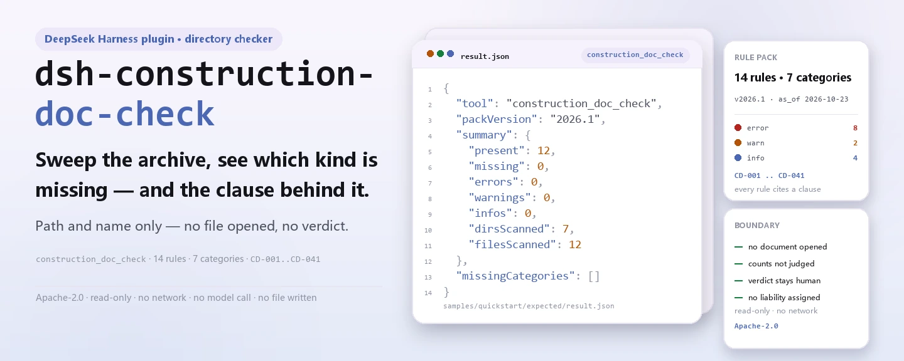
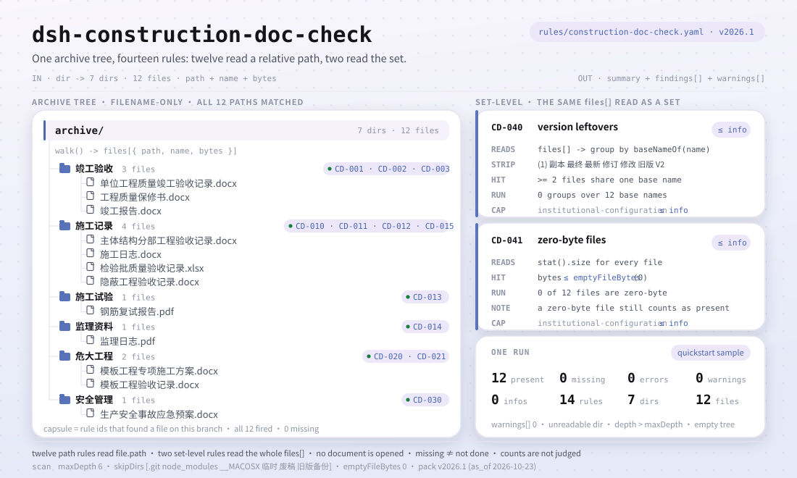

<div align="center">

<picture>
  <source media="(prefers-color-scheme: dark)" srcset="docs/assets/dsh-construction-doc-check-hero-en-dark.webp">
  
</picture>

# dsh-construction-doc-check

**Recorre el archivo documental de una obra y obtiene la lista de qué documento exigido falta y qué cláusula lo exige: el veredicto queda en manos del responsable documental y del supervisor.**

Un plugin verificador de carpetas para DeepSeek Harness: comprueba 12 tipos de documento exigidos por la ruta relativa y el nombre de archivo, añade dos comprobaciones de conjunto (revisiones residuales, archivos de cero bytes) y enumera solo las diferencias que puede señalar dentro del archivo — nunca abre un documento, dictamina cumplimiento ni atribuye responsabilidad.

[Instalar](#instalación-en-tres-pasos) · [Configuración](#configuración) · [FAQ](#faq) · [简体中文](README.md) · [English](README.en.md) · [Español](README.es.md) · [Português](README.pt.md) · [हिन्दी](README.hi.md)

[](LICENSE)
[](#compatibilidad)
[](https://www.npmjs.com/package/dsh-construction-doc-check)
[](https://github.com/PerryLink/dsh-construction-doc-check/actions/workflows/ci.yml)
[](#compatibilidad)

[](https://github.com/PerryLink/dsh-construction-doc-check/stargazers)
[](https://www.npmjs.com/package/dsh-construction-doc-check)
[](https://dshfind.com/plugins/PerryLink/dsh-construction-doc-check?ref=badge)
[](https://securityscorecards.dev/viewer/?uri=github.com/PerryLink/dsh-construction-doc-check)
[](https://gitee.com/perrylink/dsh-construction-doc-check)

```sh
dsh plugin --profile <name> add dsh-construction-doc-check
```

</div>

<sub>Plugin de la comunidad, no afiliado a DeepSeek. Repositorio canónico: <https://github.com/PerryLink/dsh-construction-doc-check> (Gitee es un espejo).</sub>

## Qué es

`dsh-construction-doc-check` recorre el archivo documental de una obra y comprueba, por ruta relativa y nombre de archivo, si está presente cada tipo de documento que declara el paquete de reglas: qué falta, qué cláusula lo exige y qué archivo del archivo cuenta. También informa de dos problemas de conjunto: un nombre de documento que aparece más de una vez (posibles revisiones residuales) y archivos de cero bytes («presente pero inutilizable»).

Lee nombres de archivo, no archivos. Es un límite deliberado: un archivo real tiene mil documentos y pedir al responsable que los transcriba antes a una tabla da más trabajo, no menos. La carpeta y los nombres son lo que ya tiene.

- **Para quién**: responsables documentales de obra, supervisores y gestión documental de la propiedad; basta con entregarle una carpeta en el chat.
- **Qué le das**: la ruta de una carpeta de documentación de obra (solo nombres y estructura de carpetas, nunca el contenido).
- **Qué devuelve**: una lista Markdown de documentos faltantes (id de regla, categoría, cláusula de base) más un `resultJson` estructurado; toda comprobación que no pudo ejecutarse lo explica en los avisos.

Responde a cuatro preguntas:

- ¿Qué tipos de documento exigidos no aparecen en ninguna parte del archivo?
- ¿Qué documentos existen en más de una revisión a la vez?
- ¿Qué archivos tienen cero bytes y, por tanto, son inutilizables?
- ¿Qué requisito falta y qué cláusula lo exige?

**Límite:** tres afirmaciones que esta herramienta no hace. No abre documentos, así que «presente» no es «correcto» — el contenido es una capa posterior (L1/L2). **No** juzga **cuántas** copias debe haber de cada tipo: un ítem puede necesitar decenas de registros de inspección por lotes, y esto comprueba existencia, no suficiencia. Y un archivo ausente significa que el archivo documental no puede probar que se hizo, no que no se hiciera.

<picture>
  <source media="(prefers-color-scheme: dark)" srcset="docs/assets/dsh-construction-doc-check-flow-v5-dark.svg">
  
</picture>

## Instalación en tres pasos

1. **Instala** (elige un canal):

   ```sh
   # canal git (último main; equivale a git+https://github.com/PerryLink/dsh-construction-doc-check.git)
   dsh plugin --profile <name> add github:PerryLink/dsh-construction-doc-check
   # canal npm (versiones publicadas)
   dsh plugin --profile <name> add dsh-construction-doc-check
   # canal tarball: pnpm pack en este repo y luego
   dsh plugin --profile <name> add ./dsh-construction-doc-check-<version>.tgz
   ```

2. **Configuración mínima** (los valores por defecto ya funcionan; una fila de bundle sin `config` usa todos los valores por defecto y apunta al paquete incluido `rules/construction-doc-check.yaml`):

   ```yaml
   - insert:
       - id: dsh-construction-doc-check
         name: dsh-construction-doc-check
   ```

3. **Verifica que se monta**: compila primero (`main` apunta a `lib/index.mjs`; el repositorio no versiona el resultado de la compilación) y ejecuta la muestra incluida:

   ```sh
   dsh --profile <name> --dump-config | grep 'dsh-construction-doc-check'
   pnpm install && pnpm run build
   node samples/quickstart/run.mjs --check
   # construction_doc_check: quickstart OK — output matches expected/result.json
   ```

   Salida de la muestra (coincide con `samples/quickstart/expected/result.json`):

   ```text
   construction_doc_check: 12 present, 0 missing — 0 error, 0 warn, 0 info (12 files, 7 dirs)
   ```

**Desinstalar**: `dsh plugin --profile <name> remove dsh-construction-doc-check` (o elimina la fila del patch del perfil).

## Capacidades clave

`dsh-construction-doc-check` registra la herramienta `construction_doc_check`: se le pasa un directorio de archivo documental, aplica el paquete de reglas versionado que incluye y devuelve un informe.

- **14 reglas en un paquete de datos** — el paquete de reglas es dato, no código (`rules/construction-doc-check.yaml`, versión `2026.1`, con fecha de referencia `2026-10-23`); sustituirlo cambia todo el conjunto de comprobaciones sin tocar una línea de TypeScript.
- **Coincide con la ruta relativa, las carpetas cuentan** — los archivos reales clasifican por carpeta (por ejemplo, un registro de aceptación guardado bajo la carpeta de obras de alto riesgo), así que la coincidencia se hace contra la ruta relativa, no solo contra el nombre.
- **Dos comprobaciones de conjunto** — `CD-040` informa de un nombre de documento que aparece más de una vez en el archivo (marcas como `(1)`, `V2` o un sufijo local para copia, final, último, revisado o versión antigua), y `CD-041` informa de archivos de cero bytes.
- **Un archivo de cero bytes sigue contando como presente** — un documento ausente y uno inutilizable se informan por separado: «hay un archivo» y «el archivo es utilizable» son dos afirmaciones distintas, y el informe hace ambas.
- **Sin citas inventadas** — cada regla lleva `document` / `number` / `clause` / `excerpt` / `kind` / `source`; `excerpt` debe ser una cita literal, y `check:citations` verifica cada una contra `rules/evidence/clauses.md`.
- **La severidad sigue a la evidencia** — `derived-from-principle` se limita a `warn` (`CD-014`), `institutional-configuration` a `info` (`CD-015`, `CD-030`, `CD-040`, `CD-041`), y un test lo asegura.
- **Solo lectura, sin red, sin llamadas al modelo** — ESM puro: recorrido de directorios, expresiones regulares sobre nombres y lectura de tamaños; los parámetros de la herramienta son `dir` / `rulePackFile` / `maxDepth`.
- **El escaneo nunca es silencioso** — los directorios ilegibles, los topes de profundidad y una carpeta vacía van a `warnings`; el informe declara su alcance antes de sus conclusiones.

### Ejemplo

Salida esperada para la muestra incluida (resumida por `samples/quickstart/run.mjs` y coincidente con `samples/quickstart/expected/result.json`):

```json
{
  "tool": "construction_doc_check",
  "packVersion": "2026.1",
  "summary": {
    "present": 12,
    "missing": 0,
    "errors": 0,
    "warnings": 0,
    "infos": 0,
    "dirsScanned": 7,
    "filesScanned": 12
  },
  "missingCategories": []
}
```

*Observed from `samples/quickstart/expected/result.json`*

## Normas que sigue

| Documento | Número | Reglas que lo citan |
|---|---|---|
| Norma unificada de aceptación de la calidad de la construcción de edificios | GB 50300-2013 | CD-001, CD-010, CD-011, CD-012 |
| Reglamento de gestión de la calidad de las obras de construcción | Decreto del Consejo de Estado n.º 279 | CD-002, CD-003, CD-013 |
| Disposiciones sobre la gestión de seguridad de las subobras de alto riesgo | Decreto n.º 37 del Ministerio de Vivienda y Desarrollo Urbano-Rural | CD-020, CD-021 |
| Medidas de administración de la supervisión en obra de la construcción de edificios (ensayo) | Jian Shi [2002] n.º 189 | CD-014 |
| Política institucional de archivo documental (configuración de la institución) | Sin norma unificada | CD-015, CD-030, CD-040, CD-041 |

**Límite:** este plugin comprueba la completitud de un **archivo documental de obra** — si cada tipo de documento exigido se encuentra por ruta relativa, si un nombre de documento aparece más de una vez (posibles revisiones residuales) y si algún archivo tiene cero bytes. **No** abre archivos, no revisa contenidos, no juzga si un formulario está bien cumplimentado, no juzga si el número de copias es suficiente ni atribuye responsabilidad. Un documento ausente solo significa que el archivo no puede probarlo, no que el trabajo no se hiciera.

> **El estado de `excerpt` es por regla, no uniforme.** Nueve reglas citan la cláusula literalmente (`kind: direct`); `CD-014` se deriva del principio de los artículos citados (`kind: derived-from-principle`, limitado a `warn`); `CD-015`, `CD-030`, `CD-040` y `CD-041` toman sus umbrales de la política de archivo de la propia institución (`kind: institutional-configuration`, limitado a `info`), y su `excerpt` dice claramente que el requisito no es una cláusula de norma nacional. `check:citations` exige que cada `excerpt` se encuentre literalmente en `rules/evidence/clauses.md`; un paquete que exagere su base falla la puerta.
>
> La conclusión es del revisor: este plugin enumera diferencias que puede señalar dentro del material y no decide hechos ni cumplimiento.

## Configuración

Todos los parámetros son campos Schemastery `Config` de `src/config.ts` (modificables desde cordis.yml). Una sustitución dirigida por id reemplaza la fila entera: repite todas las claves que necesites.

| Clave | Tipo | Valor por defecto | Descripción |
|---|---|---|---|
| `rulePackFile` | string | `rules/construction-doc-check.yaml` | Ruta del paquete de reglas, relativa a la raíz del paquete; también admite una ruta absoluta |
| `timeoutMs` | number | `120000` | Presupuesto de tiempo de espera cooperativo de la herramienta (milisegundos) |

Parámetros de escaneo del propio paquete de reglas (sección `scan` de `rules/construction-doc-check.yaml`):

| Clave | Valor por defecto | Descripción |
|---|---|---|
| `maxDepth` | `6` | Tope de profundidad de recursión; las carpetas más profundas no suelen ser de archivo, y el informe escribe un aviso al alcanzar el tope |
| `skipDirs` | `['.git', 'node_modules', '__MACOSX', …]` | Nombres de carpeta que se omiten por completo; el paquete incluido también omite tres nombres locales de carpetas temporales o de respaldo — consulta el paquete para la lista exacta |
| `emptyFileBytes` | `0` | Umbral de bytes por debajo del cual un archivo cuenta como vacío |

Ejemplo de sustitución en tu patch de perfil:

```yaml
- insert:
    - id: dsh-construction-doc-check
      name: dsh-construction-doc-check
      config:
        rulePackFile: rules/construction-doc-check.yaml
        timeoutMs: 180000
```

En la llamada, la herramienta también acepta `dir` para elegir el directorio y `maxDepth` para sustituir el tope de profundidad en esa llamada; ninguno de los dos va en el perfil.

## Formato del material

El material es un directorio y la herramienta no abre archivos. El archivo documental clasifica por carpeta, y la coincidencia se hace contra la **ruta relativa**: un registro guardado un nivel más abajo, por ejemplo bajo una carpeta de obras de alto riesgo, coincide con las reglas por su carpeta y su nombre. La extensión no interviene: el paquete solo mira palabras clave de la ruta.

Cada regla del paquete declara qué buscar:

```yaml
- id: CD-020
  title: 危大工程应有专项施工方案
  category: 危大工程
  severity: error
  patterns: [专项施工方案]
```

La cabecera del paquete también lleva los parámetros de escaneo: las carpetas de `scan.skipDirs` se omiten enteras (`.git`, `node_modules`, carpetas locales de respaldo, …) y la recursión se limita con `scan.maxDepth` (6 por defecto); al alcanzar el tope, el informe enumera las carpetas en las que no entró en lugar de fingir que el escaneo terminó. `emptyFileBytes` (0 por defecto) decide qué tan pequeño debe ser un archivo para contar como vacío.

## Fuentes de las reglas

Los datos de las reglas viven en `rules/construction-doc-check.yaml`, separados del código: cada regla lleva nombre del documento, número, cláusula según la numeración de la propia fuente, una cita literal y una URL de origen. Las citas también se registran en `rules/evidence/clauses.md`, y `check:citations` (`node scripts/check-citations.mjs`) verifica cada una: un nuevo segmento no rastreable hace fallar la puerta y la línea base solo puede encogerse.

Límites conocidos: la coincidencia es por nombre, así que un documento bien nombrado pero equivocado cuenta como presente; no se juzgan los recuentos — eso necesita el desglose por ítem (la capa L1); y un archivo muy anidado puede reportarse como ausente cuando está un nivel más abajo del tope, cosa que el informe indica al alcanzarlo.

## FAQ

<details>
<summary>¿Abre documentos y juzga si están bien cumplimentados?</summary>

No. Recorre directorios y lee nombres y tamaños de archivo, sin abrir ningún documento ni analizar contenido. Un documento bien nombrado pero equivocado sigue contando como presente: la corrección del contenido es tarea de la capa L1/L2; esta herramienta es L0.

</details>

<details>
<summary>¿Un documento ausente significa que el trabajo no se hizo?</summary>

No. Un documento ausente solo significa que el archivo no puede probarlo. El informe y los mensajes se redactan así: sin responsabilidad ni veredicto de cumplimiento; basta con completar el hueco o añadir una nota explicativa.

</details>

<details>
<summary>¿Puede decir si el número de copias es suficiente?</summary>

No. Un ítem puede necesitar decenas de registros de inspección por lotes, y esta herramienta comprueba existencia, no suficiencia. Contar requiere el desglose por ítem y pertenece a la capa L1.

</details>

<details>
<summary>El archivo es profundo, ¿se saltará algo?</summary>

Recorre 6 niveles por defecto; al alcanzar el tope, el informe enumera las carpetas en las que no entró en lugar de omitirlas en silencio. Puedes subir `scan.maxDepth` en el paquete o pasar `maxDepth` en una llamada concreta.

</details>

<details>
<summary>¿Envía datos a algún sitio? ¿Cuánto cuesta?</summary>

No. Solo recorrido local de directorios y expresiones regulares sobre nombres: sin peticiones de red, sin llamadas al modelo y sin escribir archivos. El coste crece con el número de archivos del archivo documental; `timeoutMs` (120 s por defecto) es el presupuesto de tiempo de espera cooperativo.

</details>

## Solución de problemas

- **El plugin se instala pero la herramienta no aparece**: comprueba que `main` resuelve a `lib/index.mjs` y que `pnpm run build` lo produjo; un `main` equivocado hace que el cargador omita la entrada en silencio.
- **`dsh plugin add` rechaza el paquete**: el rango de peers cubre las líneas de host `>=0.1.2-rc.1 <0.2.0` y `>=0.2.0-0 <0.3.0`; fuera de ellas, concede una exención explícita o fija la versión del host en el perfil.
- **Una regla no se ejecutó**: lee los `warnings` del resultado de la herramienta y el bloque de avisos al final del informe; los directorios ilegibles, los topes de profundidad y una carpeta vacía se registran allí.
- **La lista de faltantes nombra un documento que sí está**: confirma que está dentro de seis niveles y que su carpeta no está en `skipDirs`; sube `maxDepth` si hace falta.
- **No se encuentra el paquete de reglas**: el error enumera todas las rutas probadas; `rulePackFile` se resuelve contra la raíz del paquete y también admite una ruta absoluta.

## Compatibilidad

| Superficie | Estado |
|---|---|
| Harness | rango de peers `>=0.1.2-rc.1 <0.2.0 \|\| >=0.2.0-0 <0.3.0`; `engines.dsh` declarado como `>=0.2.1-0 <0.3.0` |
| Node | `^22.19.0 \|\| >=24.0.0` |
| Plataformas | todas (ESM puro; sin código nativo, sin red, sin llamadas al modelo) |

## Ecosistema y calidad

- [Espejo de Gitee](https://gitee.com/perrylink/dsh-construction-doc-check) (espejo sincronizado; GitHub es canónico)
- [Página del plugin en dshfind](https://dshfind.com/plugins/PerryLink/dsh-construction-doc-check) (instalaciones y ranking)
- [Informe OpenSSF Scorecard](https://securityscorecards.dev/viewer/?uri=github.com/PerryLink/dsh-construction-doc-check) (generado por [.github/workflows/scorecard.yml](.github/workflows/scorecard.yml))
- [Base de conocimiento del ecosistema](https://perrylink.github.io/dsh-plugin-guide/): guía de desarrollo de plugins · datos de selección · criterios de mantenimiento

## Desarrollo

```sh
pnpm install                                        # node ^22.19 || >=24
pnpm run typecheck                                  # tsc --noEmit
pnpm test                                           # vitest: fixtures por regla + semántica de frontera
pnpm run build                                      # tsdown -> lib/index.mjs + lib/index.d.mts
pnpm run verify:self-contained                      # las dependencias resuelven desde el registry
pnpm run check:lockfile                             # comprobación de deriva del lockfile
pnpm run check:readmes                              # consistencia de los README en cinco idiomas
pnpm run check:citations                            # línea base de citas del paquete de reglas
node ../scripts/sync-shared.mjs dsh-construction-doc-check   # refresca src/shared desde ../_shared
pnpm pack                                           # el tarball publicado
```

Ejecución local de la muestra (compila antes para que exista `lib/`):

```sh
node samples/quickstart/run.mjs --check
# construction_doc_check: quickstart OK — output matches expected/result.json
```

Estructura del directorio:

| Ruta | Función |
|---|---|
| `src/index.ts` | contrato de plugin de función: registra `construction_doc_check` y resuelve el paquete de reglas incluido |
| `src/config.ts` | configuración Schemastery (`rulePackFile` / `timeoutMs`) |
| `src/engine.ts` | núcleo de comprobación puro: recorrido, coincidencia de reglas, datos del informe |
| `src/report.ts` | informe Markdown y resultado JSON |
| `src/shared/` | kit compartido (carga del paquete de reglas, subconjunto YAML, guardia de redacción, utilidades de tabla) |
| `rules/` | paquete de reglas y registro de verificación de cláusulas en `evidence/` |
| `samples/quickstart/` | muestra incluida, salida esperada y script de ejecución |
| `tests/` | vitest: un fixture emparejado por regla |

Las imágenes del README se generan programáticamente con [`scripts/gen-readme-assets.py`](scripts/gen-readme-assets.py) — el hero con Pillow (zh/en × claro/oscuro, cuatro WebP) y la figura de estructura como SVG escrito a mano (flow-v5, claro/oscuro) — y se pueden volver a ejecutar; el diagrama de flujo, el hero y la demo de una sola versión permanecen en `docs/assets/` para enlaces externos, y los README solo referencian el nuevo hero y el par flow-v5.

Topics: `deepseek-harness`, `dsh`, `dsh-plugin`, `cordis`, `construction`, `archive`, `documents`, `completion`

## Familia y agradecimientos

Este proyecto forma parte de la familia de plugins de DeepSeek Harness de [PerryLink](https://github.com/PerryLink) (todos Apache-2.0). Índice completo: [elige un verificador por material](https://perrylink.github.io/zh/checkers/choose/) y [todos los plugins](https://github.com/PerryLink). Si te resulta útil, **una estrella ayuda a que la siguiente persona lo encuentre** — no desbloquea nada.

- [@PerryLink](https://github.com/PerryLink) — creador y mantenedor: el paquete de reglas de carpetas (CD-001..CD-041), la herramienta `construction_doc_check`, el registro de verificación de citas y la documentación en cinco idiomas.

<details>
<summary>Ver todos los plugins</summary>

| Plugin | Estado |
|---|---|
| **[dsh-aqua-input-check](https://github.com/PerryLink/dsh-aqua-input-check)** |  |
| **[dsh-archive-check](https://github.com/PerryLink/dsh-archive-check)** |  |
| **[dsh-auto-review](https://github.com/PerryLink/dsh-auto-review)** |  |
| **[dsh-autotier](https://github.com/PerryLink/dsh-autotier)** | 🧊 CONGELADO — ver el README del repo |
| **[dsh-bid-ca-precheck](https://github.com/PerryLink/dsh-bid-ca-precheck)** |  |
| **[dsh-bid-qual-check](https://github.com/PerryLink/dsh-bid-qual-check)** |  |
| **[dsh-cert-mcp](https://github.com/PerryLink/dsh-cert-mcp)** | 🧊 CONGELADO — ver el README del repo |
| **[dsh-checkpoint-rewind](https://github.com/PerryLink/dsh-checkpoint-rewind)** |  |
| **[dsh-click](https://github.com/PerryLink/dsh-click)** |  |
| **[dsh-composer-history](https://github.com/PerryLink/dsh-composer-history)** |  |
| **[dsh-contract-stance](https://github.com/PerryLink/dsh-contract-stance)** |  |
| **[dsh-customs-doc-check](https://github.com/PerryLink/dsh-customs-doc-check)** |  |
| **[dsh-data-quality](https://github.com/PerryLink/dsh-data-quality)** | 🧊 CONGELADO — ver el README del repo |
| **[dsh-demurrage-ledger](https://github.com/PerryLink/dsh-demurrage-ledger)** |  |
| **[dsh-doublecheck](https://github.com/PerryLink/dsh-doublecheck)** |  |
| **[dsh-drill-script-check](https://github.com/PerryLink/dsh-drill-script-check)** |  |
| **[dsh-eia-guide-check](https://github.com/PerryLink/dsh-eia-guide-check)** |  |
| **[dsh-emergency-plan](https://github.com/PerryLink/dsh-emergency-plan)** |  |
| **[dsh-essay-rubric-check](https://github.com/PerryLink/dsh-essay-rubric-check)** |  |
| **[dsh-evidence-check](https://github.com/PerryLink/dsh-evidence-check)** |  |
| **[dsh-export-ctl-check](https://github.com/PerryLink/dsh-export-ctl-check)** |  |
| **[dsh-fast](https://github.com/PerryLink/dsh-fast)** |  |
| **[dsh-fmea-table-check](https://github.com/PerryLink/dsh-fmea-table-check)** |  |
| **[dsh-forecast-penalty](https://github.com/PerryLink/dsh-forecast-penalty)** |  |
| **[dsh-fund-research](https://github.com/PerryLink/dsh-fund-research)** |  |
| **[dsh-github](https://github.com/PerryLink/dsh-github)** |  |
| **[dsh-gongwen-flow-check](https://github.com/PerryLink/dsh-gongwen-flow-check)** |  |
| **[dsh-gongwen-word-check](https://github.com/PerryLink/dsh-gongwen-word-check)** |  |
| **[dsh-guard-plan-qc](https://github.com/PerryLink/dsh-guard-plan-qc)** |  |
| **[dsh-hazchem-check](https://github.com/PerryLink/dsh-hazchem-check)** |  |
| **[dsh-hazplan-check](https://github.com/PerryLink/dsh-hazplan-check)** |  |
| **[dsh-hidden-risk-map](https://github.com/PerryLink/dsh-hidden-risk-map)** |  |
| **[dsh-hs-classify](https://github.com/PerryLink/dsh-hs-classify)** |  |
| **[dsh-icd-rule-check](https://github.com/PerryLink/dsh-icd-rule-check)** |  |
| **[dsh-industry-research](https://github.com/PerryLink/dsh-industry-research)** |  |
| **[dsh-lawcite-adapter](https://github.com/PerryLink/dsh-lawcite-adapter)** |  |
| **[dsh-laya](https://github.com/PerryLink/dsh-laya)** |  |
| **[dsh-lc-doc-check](https://github.com/PerryLink/dsh-lc-doc-check)** |  |
| **[dsh-learning-gap-check](https://github.com/PerryLink/dsh-learning-gap-check)** |  |
| **[dsh-library](https://github.com/PerryLink/dsh-library)** |  |
| **[dsh-local-ai](https://github.com/PerryLink/dsh-local-ai)** |  |
| **[dsh-lsp-actions](https://github.com/PerryLink/dsh-lsp-actions)** |  |
| **[dsh-mask](https://github.com/PerryLink/dsh-mask)** |  |
| **[dsh-mcp-panel](https://github.com/PerryLink/dsh-mcp-panel)** |  |
| **[dsh-medrec-qc](https://github.com/PerryLink/dsh-medrec-qc)** |  |
| **[dsh-memento](https://github.com/PerryLink/dsh-memento)** | 🧊 CONGELADO — ver el README del repo |
| **[dsh-nsfc-form-check](https://github.com/PerryLink/dsh-nsfc-form-check)** |  |
| **[dsh-nurse-record-check](https://github.com/PerryLink/dsh-nurse-record-check)** |  |
| **[dsh-observe](https://github.com/PerryLink/dsh-observe)** |  |
| **[dsh-origin-rvc-check](https://github.com/PerryLink/dsh-origin-rvc-check)** |  |
| **[dsh-ota-review-check](https://github.com/PerryLink/dsh-ota-review-check)** |  |
| **[dsh-output-styles](https://github.com/PerryLink/dsh-output-styles)** |  |
| **[dsh-paper-doc-adapter](https://github.com/PerryLink/dsh-paper-doc-adapter)** |  |
| **[dsh-permission-rules](https://github.com/PerryLink/dsh-permission-rules)** |  |
| **[dsh-permit-report-check](https://github.com/PerryLink/dsh-permit-report-check)** |  |
| **[dsh-pipeline-check](https://github.com/PerryLink/dsh-pipeline-check)** |  |
| **[dsh-pleading-draft](https://github.com/PerryLink/dsh-pleading-draft)** |  |
| **[dsh-plugin-doctor](https://github.com/PerryLink/dsh-plugin-doctor)** | 🚫 RETIRADO (repo archivado) |
| **[dsh-plugin-guide](https://github.com/PerryLink/dsh-plugin-guide)** |  |
| **[dsh-plugin-kit](https://github.com/PerryLink/dsh-plugin-kit)** | 🚫 RETIRADO (repo archivado) |
| **[dsh-plugin-upgrade](https://github.com/PerryLink/dsh-plugin-upgrade)** | 🚫 RETIRADO (repo archivado) |
| **[dsh-policy-brief-draft](https://github.com/PerryLink/dsh-policy-brief-draft)** |  |
| **[dsh-power-loss-split](https://github.com/PerryLink/dsh-power-loss-split)** |  |
| **[dsh-power-ticket-check](https://github.com/PerryLink/dsh-power-ticket-check)** |  |
| **[dsh-ppap-check](https://github.com/PerryLink/dsh-ppap-check)** |  |
| **[dsh-protest-deadline](https://github.com/PerryLink/dsh-protest-deadline)** |  |
| **[dsh-railway-window](https://github.com/PerryLink/dsh-railway-window)** |  |
| **[dsh-repair-order-qc](https://github.com/PerryLink/dsh-repair-order-qc)** |  |
| **[dsh-research-report](https://github.com/PerryLink/dsh-research-report)** |  |
| **[dsh-review-reply-check](https://github.com/PerryLink/dsh-review-reply-check)** |  |
| **[dsh-rulefile-check](https://github.com/PerryLink/dsh-rulefile-check)** |  |
| **[dsh-safety-brief-check](https://github.com/PerryLink/dsh-safety-brief-check)** |  |
| **[dsh-score](https://github.com/PerryLink/dsh-score)** | 🧊 CONGELADO — ver el README del repo |
| **[dsh-session-sync](https://github.com/PerryLink/dsh-session-sync)** |  |
| **[dsh-site-log-check](https://github.com/PerryLink/dsh-site-log-check)** |  |
| **[dsh-skill-pack-security](https://github.com/PerryLink/dsh-skill-pack-security)** |  |
| **[dsh-soe-decision-check](https://github.com/PerryLink/dsh-soe-decision-check)** |  |
| **[dsh-soilwater-check](https://github.com/PerryLink/dsh-soilwater-check)** |  |
| **[dsh-sop-sync-check](https://github.com/PerryLink/dsh-sop-sync-check)** |  |
| **[dsh-spc-gbt-adapter](https://github.com/PerryLink/dsh-spc-gbt-adapter)** |  |
| **[dsh-talk](https://github.com/PerryLink/dsh-talk)** |  |
| **[dsh-tender-extract](https://github.com/PerryLink/dsh-tender-extract)** |  |
| **[dsh-tender-matrix](https://github.com/PerryLink/dsh-tender-matrix)** |  |
| **[dsh-test-drive](https://github.com/PerryLink/dsh-test-drive)** |  |
| **[dsh-ticktick](https://github.com/PerryLink/dsh-ticktick)** | 🚫 RETIRADO (repo archivado) |
| **[dsh-translate](https://github.com/PerryLink/dsh-translate)** |  |
| **[dsh-warranty-calc](https://github.com/PerryLink/dsh-warranty-calc)** |  |
| **[dsh-budget](https://github.com/PerryLink/dsh-budget)** | 🧊 CONGELADO — ver el README del repo |
| **[dsh-claude-move](https://github.com/PerryLink/dsh-claude-move)** | 🧊 CONGELADO — ver el README del repo |
| **[dsh-defend](https://github.com/PerryLink/dsh-defend)** | 🧊 CONGELADO — ver el README del repo |
| **[dsh-draw](https://github.com/PerryLink/dsh-draw)** | 🧊 CONGELADO — ver el README del repo |
| **[dsh-reach](https://github.com/PerryLink/dsh-reach)** | 🧊 CONGELADO — ver el README del repo |
| **[dsh-background-agents](https://github.com/PerryLink/dsh-background-agents)** | 🚫 RETIRADO (repo archivado) |
| **[dsh-session-pin](https://github.com/PerryLink/dsh-session-pin)** | 🚫 RETIRADO (repo archivado) |
| **[dsh-team-rooms](https://github.com/PerryLink/dsh-team-rooms)** | 🚫 RETIRADO (repo archivado) |

</details>

## Licencia

[LICENSE](LICENSE) (Apache License 2.0) © 2026 dsh-construction-doc-check contributors

<p align="center"><sub>Apache-2.0 · Plugin de la comunidad, no afiliado a DeepSeek.</sub></p>
