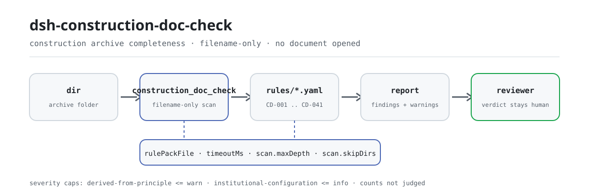

<div align="center">

<picture>
  <source media="(prefers-color-scheme: dark)" srcset="docs/assets/dsh-construction-doc-check-flow-dark.svg">
  
</picture>

# dsh-construction-doc-check

**निर्माण परियोजना के दस्तावेज़ संग्रह पर एक बार चलाइए और पाइए «कौन-सा अनिवार्य दस्तावेज़ अनुपस्थित है और कौन-सा अनुच्छेद उसे अनिवार्य करता है» — निर्णय दस्तावेज़ प्रभारी और पर्यवेक्षक के पास रहता है।**

DeepSeek Harness के लिए एक फ़ोल्डर-स्तरीय जाँच प्लगइन: सापेक्ष पथ और फ़ाइल नाम से 12 अनिवार्य दस्तावेज़ प्रकार जाँचता है, दो समुच्चय-स्तरीय जाँचें (पुराने संस्करण, शून्य-बाइट फ़ाइलें) जोड़ता है, और केवल वही अंतर सूचीबद्ध करता है जिन्हें संग्रह के भीतर इंगित किया जा सके — कभी कोई दस्तावेज़ नहीं खोलता, अनुपालन का निर्णय नहीं देता, उत्तरदायित्व निर्धारित नहीं करता।

[इंस्टॉल](#तीन-चरणों-में-शुरुआत) · [कॉन्फ़िगरेशन](#कॉन्फ़िगरेशन) · [FAQ](#faq) · [简体中文](README.md) · [English](README.en.md) · [Español](README.es.md) · [Português](README.pt.md) · [हिन्दी](README.hi.md)

[](LICENSE)
[](#संगतता)
[](https://www.npmjs.com/package/dsh-construction-doc-check)
[](https://github.com/PerryLink/dsh-construction-doc-check/actions/workflows/ci.yml)
[](#संगतता)

[](https://github.com/PerryLink/dsh-construction-doc-check/stargazers)
[](https://www.npmjs.com/package/dsh-construction-doc-check)
[](https://dshfind.com/plugins/PerryLink/dsh-construction-doc-check?ref=badge)
[](https://securityscorecards.dev/viewer/?uri=github.com/PerryLink/dsh-construction-doc-check)
[](https://gitee.com/perrylink/dsh-construction-doc-check)

```sh
dsh plugin --profile <name> add dsh-construction-doc-check
```

</div>

<sub>सामुदायिक प्लगइन, DeepSeek से असंबद्ध। आधिकारिक रेपो: <https://github.com/PerryLink/dsh-construction-doc-check> (Gitee एक मिरर है)।</sub>

## यह क्या है

`dsh-construction-doc-check` किसी निर्माण परियोजना की दस्तावेज़ संग्रह निर्देशिका पर चलता है और सापेक्ष पथ तथा फ़ाइल नाम से जाँचता है कि नियम-पैक में सूचीबद्ध हर दस्तावेज़ प्रकार मौजूद है या नहीं: कौन-सा प्रकार अनुपस्थित है, कौन-सा अनुच्छेद उसे अनिवार्य करता है, और संग्रह में कौन-सी फ़ाइल गिनी जाती है। यह दो समुच्चय-स्तरीय समस्याएँ भी बताता है: एक ही दस्तावेज़ नाम एक से अधिक बार आना (संभवतः पुराने संस्करण बचे होना), और शून्य-बाइट फ़ाइलें («मौजूद पर अनुपयोगी»)।

यह फ़ाइल के नाम पढ़ता है, फ़ाइल नहीं। यह जानबूझकर तय की गई सीमा है: वास्तविक संग्रह में हज़ार दस्तावेज़ होते हैं, और पहले उन्हें तालिका में उतारने को कहना काम बढ़ाना है, घटाना नहीं। निर्देशिका और फ़ाइल नाम वही हैं जो उसके पास पहले से हैं।

- **किसके लिए है**: निर्माण दस्तावेज़ प्रभारी, पर्यवेक्षक और स्वामी-पक्ष का दस्तावेज़ प्रबंधन; चैट में केवल एक फ़ोल्डर सौंप दीजिए।
- **आप क्या देते हैं**: निर्माण परियोजना के दस्तावेज़ फ़ोल्डर का पथ (केवल फ़ाइल नाम और निर्देशिका संरचना, फ़ाइल की सामग्री कभी नहीं)।
- **आपको क्या मिलता है**: Markdown में अनुपस्थित दस्तावेज़ों की सूची (नियम आईडी, श्रेणी, आधार अनुच्छेद) और संरचित `resultJson`; जो जाँच चल नहीं पाई वह चेतावनियों में कारण बताती है।

यह चार प्रश्नों का उत्तर देता है:

- कौन-से अनिवार्य दस्तावेज़ प्रकार संग्रह में कहीं नहीं मिले?
- कौन-से दस्तावेज़ एक साथ कई संस्करणों में हैं?
- कौन-सी फ़ाइलें शून्य बाइट की हैं, यानी मौजूद पर अनुपयोगी?
- कौन-सी आवश्यकता छूटी और कौन-सा अनुच्छेद उसे अनिवार्य करता है?

**सीमा:** तीन बातें यह उपकरण नहीं कहता। यह दस्तावेज़ नहीं खोलता, इसलिए «मौजूद» का अर्थ «सही» नहीं — सामग्री की जाँच बाद की परत (L1/L2) है। यह **कितनी** प्रतियाँ होनी चाहिए यह नहीं आँकता: एक उप-मद के लिए दर्जनों निरीक्षण-बैच रिकॉर्ड चाहिए हो सकते हैं, और यह अस्तित्व जाँचता है, पर्याप्तता नहीं। और फ़ाइल का अनुपस्थित होना बताता है कि संग्रह प्रमाण नहीं दे सकता, यह नहीं कि काम हुआ ही नहीं।

## तीन चरणों में शुरुआत

1. **इंस्टॉल करें** (कोई एक चैनल चुनें):

   ```sh
   # git चैनल (नवीनतम main; git+https://github.com/PerryLink/dsh-construction-doc-check.git के समतुल्य)
   dsh plugin --profile <name> add github:PerryLink/dsh-construction-doc-check
   # npm चैनल (प्रकाशित संस्करण)
   dsh plugin --profile <name> add dsh-construction-doc-check
   # tarball चैनल: इस रेपो में pnpm pack करके, फिर
   dsh plugin --profile <name> add ./dsh-construction-doc-check-<version>.tgz
   ```

2. **न्यूनतम कॉन्फ़िग** (डिफ़ॉल्ट पर भी चलता है; बिना `config` वाली bundle पंक्ति सभी डिफ़ॉल्ट लेती है और नियम-पैक का पथ साथ आए `rules/construction-doc-check.yaml` की ओर इशारा करता है):

   ```yaml
   - insert:
       - id: dsh-construction-doc-check
         name: dsh-construction-doc-check
   ```

3. **सत्यापित करें कि माउंट हुआ**: पहले बिल्ड करें (`main` का लक्ष्य `lib/index.mjs` है; रेपो बिल्ड आउटपुट संग्रहीत नहीं करता), फिर साथ आई नमूना फ़ाइल चलाएँ:

   ```sh
   dsh --profile <name> --dump-config | grep 'dsh-construction-doc-check'
   pnpm install && pnpm run build
   node samples/quickstart/run.mjs --check
   # construction_doc_check: quickstart OK — output matches expected/result.json
   ```

   नमूना आउटपुट (`samples/quickstart/expected/result.json` के अनुरूप):

   ```text
   construction_doc_check: 12 present, 0 missing — 0 error, 0 warn, 0 info (12 files, 7 dirs)
   ```

**अनइंस्टॉल**: `dsh plugin --profile <name> remove dsh-construction-doc-check` (या प्रोफ़ाइल पैच से वह पंक्ति हटा दें)।

## मुख्य क्षमताएँ

`dsh-construction-doc-check` उपकरण `construction_doc_check` पंजीकृत करता है: इसे दस्तावेज़ संग्रह की निर्देशिका दीजिए, यह साथ आया संस्करणित नियम-पैक लागू करता है और एक रिपोर्ट लौटाता है।

- **एक डेटा पैक में 14 नियम** — नियम-पैक कोड नहीं, डेटा है (`rules/construction-doc-check.yaml`, संस्करण `2026.1`, संदर्भ तिथि `2026-10-23`); उसे बदलने से पूरा नियम-सेट बदल जाता है, TypeScript की एक भी पंक्ति छुए बिना।
- **सापेक्ष पथ से मिलान, फ़ोल्डर भी गिने जाते हैं** — वास्तविक संग्रह फ़ोल्डर के अनुसार वर्गीकृत होते हैं (जैसे उच्च-जोखिम कार्यों के फ़ोल्डर में रखा कोई स्वीकृति रिकॉर्ड), इसलिए मिलान सापेक्ष पथ पर होता है, केवल फ़ाइल नाम पर नहीं।
- **दो समुच्चय-स्तरीय जाँचें** — `CD-040` संग्रह में एक ही दस्तावेज़ नाम के एक से अधिक बार आने की सूचना देता है (`(1)`, `V2` या प्रति/अंतिम/नवीनतम/संशोधित/पुराना संस्करण जैसे स्थानीय प्रत्यय), और `CD-041` शून्य-बाइट फ़ाइलें बताता है।
- **शून्य-बाइट फ़ाइल भी «मौजूद» गिनी जाती है** — अनुपस्थित दस्तावेज़ और अनुपयोगी दस्तावेज़ अलग-अलग बताए जाते हैं: «एक फ़ाइल है» और «वह फ़ाइल उपयोगी है» दो अलग कथन हैं, और रिपोर्ट दोनों लिखती है।
- **कोई गढ़ा हुआ उद्धरण नहीं** — हर नियम में `document` / `number` / `clause` / `excerpt` / `kind` / `source` होता है; `excerpt` शब्दशः उद्धरण होना चाहिए, और `check:citations` हर एक को `rules/evidence/clauses.md` के विरुद्ध जाँचता है।
- **गंभीरता साक्ष्य के अनुसार** — `derived-from-principle` की अधिकतम सीमा `warn` (`CD-014`), `institutional-configuration` की `info` (`CD-015`, `CD-030`, `CD-040`, `CD-041`); एक टेस्ट इसे लागू करता है।
- **केवल-पठन, कोई नेटवर्क नहीं, कोई मॉडल कॉल नहीं** — शुद्ध ESM: निर्देशिका भ्रमण, फ़ाइल नाम पर रेगुलर एक्सप्रेशन और फ़ाइल आकार पढ़ना; उपकरण के पैरामीटर `dir` / `rulePackFile` / `maxDepth` हैं।
- **स्कैन कभी चुप नहीं रहता** — अपठनीय निर्देशिकाएँ, गहराई की सीमा और खाली फ़ोल्डर सब `warnings` में दर्ज होते हैं; रिपोर्ट निष्कर्षों से पहले अपना दायरा बताती है।

### उदाहरण

साथ आई नमूना फ़ाइल के लिए अपेक्षित आउटपुट (`samples/quickstart/run.mjs` द्वारा सारांशित, `samples/quickstart/expected/result.json` के अनुरूप):

```json
{
  "tool": "construction_doc_check",
  "packVersion": "2026.1",
  "summary": {
    "present": 12,
    "missing": 0,
    "errors": 0,
    "warnings": 0,
    "infos": 0,
    "dirsScanned": 7,
    "filesScanned": 12
  },
  "missingCategories": []
}
```

*Observed from `samples/quickstart/expected/result.json`*

## यह किन मानकों पर आधारित है

| दस्तावेज़ | संख्या | इसे उद्धृत करने वाले नियम |
|---|---|---|
| भवन अभियांत्रिकी निर्माण गुणवत्ता स्वीकृति एकीकृत मानक | GB 50300-2013 | CD-001, CD-010, CD-011, CD-012 |
| निर्माण परियोजना गुणवत्ता प्रबंधन विनियम | राज्य परिषद आदेश सं. 279 | CD-002, CD-003, CD-013 |
| उच्च-जोखिम उप-परियोजनाओं के सुरक्षा प्रबंधन के प्रावधान | आवास एवं शहरी-ग्रामीण विकास मंत्रालय आदेश सं. 37 | CD-020, CD-021 |
| भवन निर्माण के स्थल पर्यवेक्षण प्रशासन के उपाय (परीक्षण) | Jian Shi [2002] सं. 189 | CD-014 |
| संस्थागत दस्तावेज़ संग्रह नीति (संस्थागत कॉन्फ़िगरेशन) | कोई एकीकृत मानक नहीं | CD-015, CD-030, CD-040, CD-041 |

**सीमा:** यह प्लगइन एक **निर्माण दस्तावेज़ संग्रह** की पूर्णता जाँचता है — क्या हर अनिवार्य दस्तावेज़ प्रकार सापेक्ष पथ से मिलता है, क्या एक ही दस्तावेज़ नाम एक से अधिक बार आता है (संभवतः पुराने संस्करण बचे हों), और क्या कोई फ़ाइल शून्य बाइट की है। यह फ़ाइलें **नहीं** खोलता, सामग्री नहीं देखता, फ़ॉर्म सही भरा है या नहीं इसका निर्णय नहीं देता, प्रतियों की संख्या पर्याप्त है या नहीं यह नहीं आँकता, और उत्तरदायित्व निर्धारित नहीं करता। अनुपस्थित दस्तावेज़ का अर्थ केवल यह है कि संग्रह प्रमाण नहीं दे सकता, यह नहीं कि काम नहीं हुआ।

> **`excerpt` की स्थिति हर नियम में अलग है, एक-सी नहीं।** नौ नियम अनुच्छेद को शब्दशः उद्धृत करते हैं (`kind: direct`); `CD-014` उद्धृत अनुच्छेदों के सिद्धांत से व्युत्पन्न है (`kind: derived-from-principle`, अधिकतम `warn`); `CD-015`, `CD-030`, `CD-040` और `CD-041` की सीमाएँ संस्था की अपनी संग्रह नीति से आती हैं (`kind: institutional-configuration`, अधिकतम `info`), और उनका `excerpt` स्पष्ट कहता है कि यह राष्ट्रीय मानक का अनुच्छेद नहीं है। `check:citations` चाहता है कि हर `excerpt` `rules/evidence/clauses.md` में शब्दशः मिले; अपना आधार बढ़ा-चढ़ाकर बताने वाला नियम-पैक गेट पर विफल होता है।
>
> निर्णय समीक्षक का है: यह प्लगइन केवल वे अंतर सूचीबद्ध करता है जिन्हें सामग्री के भीतर इंगित किया जा सके, तथ्य या अनुपालन का निर्णय नहीं करता।

## कॉन्फ़िगरेशन

सभी समायोज्य `src/config.ts` में Schemastery `Config` फ़ील्ड हैं (cordis.yml से बदले जा सकते हैं)। id के अनुसार ओवरराइड पूरी पंक्ति बदल देता है — जिन भी कुंजियों की ज़रूरत हो, सब दोहराइए।

| कुंजी | प्रकार | डिफ़ॉल्ट | विवरण |
|---|---|---|---|
| `rulePackFile` | string | `rules/construction-doc-check.yaml` | नियम-पैक का पथ, पैकेज रूट के सापेक्ष; पूर्ण पथ भी स्वीकार्य है |
| `timeoutMs` | number | `120000` | उपकरण का सहकारी समय-सीमा बजट (मिलीसेकंड) |

नियम-पैक के अपने स्कैन पैरामीटर (`rules/construction-doc-check.yaml` का `scan` खंड):

| कुंजी | डिफ़ॉल्ट | विवरण |
|---|---|---|
| `maxDepth` | `6` | पुनरावृत्ति गहराई की सीमा; इससे गहरे फ़ोल्डर सामान्यतः संग्रह फ़ोल्डर नहीं होते, और सीमा छूने पर रिपोर्ट चेतावनी लिखती है |
| `skipDirs` | `['.git', 'node_modules', '__MACOSX', …]` | पूरे छोड़े जाने वाले फ़ोल्डर नाम; साथ आया पैक तीन स्थानीय अस्थायी/बैकअप फ़ोल्डर नाम भी छोड़ता है — सटीक सूची पैक में देखें |
| `emptyFileBytes` | `0` | इस बाइट-सीमा से छोटी फ़ाइल खाली गिनी जाती है |

प्रोफ़ाइल पैच में ओवरराइड का उदाहरण:

```yaml
- insert:
    - id: dsh-construction-doc-check
      name: dsh-construction-doc-check
      config:
        rulePackFile: rules/construction-doc-check.yaml
        timeoutMs: 180000
```

कॉल के समय उपकरण `dir` से निर्देशिका और `maxDepth` से उस एक कॉल की गहराई सीमा बदल सकता है; ये दोनों प्रोफ़ाइल में नहीं जाते।

## सामग्री प्रारूप

सामग्री एक निर्देशिका है, और उपकरण फ़ाइलें नहीं खोलता। संग्रह फ़ोल्डर के अनुसार वर्गीकृत होता है, और मिलान **सापेक्ष पथ** पर होता है: एक स्तर नीचे रखा रिकॉर्ड, जैसे उच्च-जोखिम कार्यों के फ़ोल्डर के अंतर्गत, अपने फ़ोल्डर और नाम से संबंधित नियमों से मेल खाता है। एक्सटेंशन कोई भूमिका नहीं निभाता — पैक केवल पथ के कीवर्ड देखता है।

पैक का हर नियम घोषित करता है कि क्या मिलाना है:

```yaml
- id: CD-020
  title: 危大工程应有专项施工方案
  category: 危大工程
  severity: error
  patterns: [专项施工方案]
```

पैक के हेडर में स्कैन पैरामीटर भी हैं: `scan.skipDirs` में नामित फ़ोल्डर पूरे छोड़े जाते हैं (`.git`, `node_modules`, स्थानीय बैकअप फ़ोल्डर, …), और पुनरावृत्ति `scan.maxDepth` (डिफ़ॉल्ट 6) से सीमित है; सीमा छूने पर रिपोर्ट उन फ़ोल्डरों को सूचीबद्ध करती है जिनमें वह नहीं गया, यह दिखावा नहीं करती कि स्कैन पूरा हो गया। `emptyFileBytes` (डिफ़ॉल्ट 0) तय करता है कि फ़ाइल कितनी छोटी हो तो खाली गिनी जाए।

## नियमों के स्रोत

नियमों का डेटा `rules/construction-doc-check.yaml` में है, कोड से अलग: हर नियम में दस्तावेज़ का नाम, संख्या, स्रोत की अपनी क्रमांकन प्रणाली के अनुसार अनुच्छेद, शब्दशः उद्धरण और स्रोत URL होता है। उद्धरण `rules/evidence/clauses.md` में भी दर्ज हैं, और `check:citations` (`node scripts/check-citations.mjs`) हर एक को जाँचता है: नया अप्रमाणित खंड गेट विफल करता है, और आधार-रेखा केवल छोटी हो सकती है।

ज्ञात सीमाएँ: मिलान नाम से होता है, इसलिए सही नाम वाला गलत दस्तावेज़ भी «मौजूद» गिना जाता है; प्रतियों की संख्या नहीं आँकी जाती — उसके लिए उप-मद विवरण (L1 परत) चाहिए; और बहुत गहरा संग्रह किसी मौजूद फ़ाइल को अनुपस्थित बता सकता है जब वह सीमा से एक स्तर नीचे हो, जो रिपोर्ट सीमा छूने पर बताती है।

## FAQ

<details>
<summary>क्या यह दस्तावेज़ खोलता है और जाँचता है कि वे सही भरे हैं?</summary>

नहीं। यह निर्देशिकाओं में चलता है और केवल फ़ाइल नाम व आकार पढ़ता है, कोई दस्तावेज़ नहीं खोलता, कोई सामग्री नहीं पढ़ता। सही नाम वाला गलत दस्तावेज़ भी «मौजूद» गिना जाता है — सामग्री की शुद्धता L1/L2 परत का काम है; यह उपकरण L0 है।

</details>

<details>
<summary>क्या अनुपस्थित दस्तावेज़ का अर्थ है कि काम नहीं हुआ?</summary>

नहीं। अनुपस्थित दस्तावेज़ का अर्थ केवल यह है कि संग्रह प्रमाण नहीं दे सकता। रिपोर्ट और संदेश इसी भाषा में लिखे जाते हैं: कोई उत्तरदायित्व नहीं, कोई अनुपालन-निर्णय नहीं; कमी पूरी करें या व्याख्यात्मक टिप्पणी जोड़ें।

</details>

<details>
<summary>क्या यह बता सकता है कि प्रतियों की संख्या पर्याप्त है?</summary>

नहीं। एक उप-मद के लिए दर्जनों निरीक्षण-बैच रिकॉर्ड चाहिए हो सकते हैं, और यह उपकरण अस्तित्व जाँचता है, पर्याप्तता नहीं। गिनती के लिए उप-मद विवरण चाहिए और वह L1 परत का काम है।

</details>

<details>
<summary>संग्रह बहुत गहरा है — क्या कुछ छूट जाएगा?</summary>

डिफ़ॉल्ट रूप से 6 स्तर तक जाता है; सीमा छूने पर रिपोर्ट उन फ़ोल्डरों को सूचीबद्ध करती है जिनमें वह नहीं गया, चुपचाप छोड़ती नहीं। पैक में `scan.maxDepth` बढ़ाइए, या एक कॉल में `maxDepth` भेजिए।

</details>

<details>
<summary>क्या डेटा कहीं बाहर जाता है? खर्च कितना है?</summary>

नहीं। केवल स्थानीय निर्देशिका भ्रमण और फ़ाइल नाम पर रेगुलर एक्सप्रेशन — कोई नेटवर्क अनुरोध नहीं, कोई मॉडल कॉल नहीं, और कोई फ़ाइल नहीं लिखी जाती। खर्च संग्रह में फ़ाइलों की संख्या के अनुपात में बढ़ता है; `timeoutMs` (डिफ़ॉल्ट 120 सेकंड) सहकारी समय-सीमा बजट है।

</details>

## समस्या निवारण

- **प्लगइन इंस्टॉल हो गया पर उपकरण नहीं दिखता**: जाँचें कि `main` का लक्ष्य `lib/index.mjs` है और `pnpm run build` ने उसे बनाया है; गलत `main` पर लोडर प्रविष्टि चुपचाप छोड़ देता है।
- **`dsh plugin add` असंगतता के कारण मना करता है**: peer सीमा होस्ट की `>=0.1.2-rc.1 <0.2.0` और `>=0.2.0-0 <0.3.0` पंक्तियों को कवर करती है; उनके बाहर स्पष्ट छूट दें या प्रोफ़ाइल में होस्ट संस्करण स्थिर करें।
- **कोई नियम नहीं चला**: उपकरण परिणाम के `warnings` और रिपोर्ट के अंत की चेतावनी सूची पढ़ें; अपठनीय निर्देशिका, गहराई सीमा और खाली फ़ोल्डर वहीं दर्ज होते हैं।
- **अनुपस्थित सूची में वह दस्तावेज़ आ गया जो संग्रह में है**: जाँचें कि वह छह स्तरों के भीतर है और उसका फ़ोल्डर `skipDirs` में नहीं है; ज़रूरत हो तो `maxDepth` बढ़ाइए।
- **नियम-पैक नहीं मिलता**: त्रुटि सभी आज़माए गए पथ बताती है; `rulePackFile` पैकेज रूट के सापेक्ष हल होता है और पूर्ण पथ भी स्वीकार्य है।

## संगतता

| सतह | स्थिति |
|---|---|
| Harness | peer सीमा `>=0.1.2-rc.1 <0.2.0 \|\| >=0.2.0-0 <0.3.0`; `engines.dsh` घोषित `>=0.2.1-0 <0.3.0` |
| Node | `^22.19.0 \|\| >=24.0.0` |
| प्लेटफ़ॉर्म | सभी (शुद्ध ESM; कोई नेटिव कोड नहीं, कोई नेटवर्क नहीं, कोई मॉडल कॉल नहीं) |

## इकोसिस्टम और गुणवत्ता

- [Gitee मिरर](https://gitee.com/perrylink/dsh-construction-doc-check) (सिंक मिरर; GitHub आधिकारिक है)
- [dshfind प्लगइन पृष्ठ](https://dshfind.com/plugins/PerryLink/dsh-construction-doc-check) (इंस्टॉल और रैंकिंग)
- [OpenSSF Scorecard रिपोर्ट](https://securityscorecards.dev/viewer/?uri=github.com/PerryLink/dsh-construction-doc-check) ([.github/workflows/scorecard.yml](.github/workflows/scorecard.yml) से संचालित)
- [इकोसिस्टम ज्ञान-कोश](https://perrylink.github.io/dsh-plugin-guide/): प्लगइन विकास मार्गदर्शिका · चयन डेटा · रखरखाव के मानदंड

## डेवलपमेंट

```sh
pnpm install                                        # node ^22.19 || >=24
pnpm run typecheck                                  # tsc --noEmit
pnpm test                                           # vitest: प्रति-नियम फ़िक्सचर + सीमा-अर्थशास्त्र
pnpm run build                                      # tsdown -> lib/index.mjs + lib/index.d.mts
pnpm run verify:self-contained                      # निर्भरताएँ registry से हल होती हैं
pnpm run check:lockfile                             # lockfile ड्रिफ्ट जाँच
pnpm run check:readmes                              # पाँच-भाषा README एकरूपता
pnpm run check:citations                            # नियम-पैक उद्धरण आधार-रेखा
node ../scripts/sync-shared.mjs dsh-construction-doc-check   # ../_shared से src/shared ताज़ा करें
pnpm pack                                           # प्रकाशित tarball
```

स्थानीय नमूना रन (पहले बिल्ड करें ताकि `lib/` बने):

```sh
node samples/quickstart/run.mjs --check
# construction_doc_check: quickstart OK — output matches expected/result.json
```

निर्देशिका संरचना:

| पथ | उद्देश्य |
|---|---|
| `src/index.ts` | फ़ंक्शन-प्लगइन अनुबंध: `construction_doc_check` पंजीकृत करता है, साथ आया नियम-पैक हल करता है |
| `src/config.ts` | Schemastery कॉन्फ़िग (`rulePackFile` / `timeoutMs`) |
| `src/engine.ts` | शुद्ध जाँच कोर: निर्देशिका भ्रमण, नियम मिलान, रिपोर्ट डेटा |
| `src/report.ts` | Markdown रिपोर्ट और JSON परिणाम |
| `src/shared/` | साझा किट (नियम-पैक लोडर, YAML उपसमुच्चय, शब्द-गार्ड, तालिका सहायक) |
| `rules/` | नियम-पैक और `evidence/` में अनुच्छेद-सत्यापन रिकॉर्ड |
| `samples/quickstart/` | साथ आया नमूना, अपेक्षित आउटपुट और रन स्क्रिप्ट |
| `tests/` | vitest: हर नियम के लिए जोड़ीदार फ़िक्सचर |

README की तस्वीरें [`scripts/gen-readme-assets.py`](scripts/gen-readme-assets.py) से प्रोग्रामेटिक रूप से बनती हैं (Python + Pillow) और दोबारा चलाई जा सकती हैं; पुराना एक-संस्करण फ़्लो डायग्राम, hero और डेमो `docs/assets/` में बाहरी लिंक के लिए रहते हैं, और README केवल नए लाइट/डार्क जोड़े का संदर्भ देते हैं।

Topics: `deepseek-harness`, `dsh`, `dsh-plugin`, `cordis`, `construction`, `archive`, `documents`, `completion`

## परिवार और आभार

यह परियोजना [PerryLink](https://github.com/PerryLink) के DeepSeek Harness प्लगइन परिवार का हिस्सा है (सभी Apache-2.0)। पूरा सूचकांक: [सामग्री के अनुसार जाँचकर्ता चुनें](https://perrylink.github.io/zh/checkers/choose/) और [सभी प्लगइन](https://github.com/PerryLink)। अगर यह उपयोगी लगे, तो **एक star अगले व्यक्ति को इसे खोजने में मदद करता है** — इसके पीछे कोई सुविधा नहीं है।

- [@PerryLink](https://github.com/PerryLink) — निर्माता और अनुरक्षक: फ़ोल्डर-स्तरीय नियम-पैक (CD-001..CD-041), `construction_doc_check` उपकरण, उद्धरण-सत्यापन रिकॉर्ड और पाँच-भाषा दस्तावेज़।

<details>
<summary>सभी प्लगइन दिखाएँ</summary>

| प्लगइन | स्थिति |
|---|---|
| **[dsh-aqua-input-check](https://github.com/PerryLink/dsh-aqua-input-check)** |  |
| **[dsh-archive-check](https://github.com/PerryLink/dsh-archive-check)** |  |
| **[dsh-auto-review](https://github.com/PerryLink/dsh-auto-review)** |  |
| **[dsh-autotier](https://github.com/PerryLink/dsh-autotier)** | 🧊 फ़्रोज़न — रेपो README देखें |
| **[dsh-bid-ca-precheck](https://github.com/PerryLink/dsh-bid-ca-precheck)** |  |
| **[dsh-bid-qual-check](https://github.com/PerryLink/dsh-bid-qual-check)** |  |
| **[dsh-cert-mcp](https://github.com/PerryLink/dsh-cert-mcp)** | 🧊 फ़्रोज़न — रेपो README देखें |
| **[dsh-checkpoint-rewind](https://github.com/PerryLink/dsh-checkpoint-rewind)** |  |
| **[dsh-click](https://github.com/PerryLink/dsh-click)** |  |
| **[dsh-composer-history](https://github.com/PerryLink/dsh-composer-history)** |  |
| **[dsh-contract-stance](https://github.com/PerryLink/dsh-contract-stance)** |  |
| **[dsh-customs-doc-check](https://github.com/PerryLink/dsh-customs-doc-check)** |  |
| **[dsh-data-quality](https://github.com/PerryLink/dsh-data-quality)** | 🧊 फ़्रोज़न — रेपो README देखें |
| **[dsh-demurrage-ledger](https://github.com/PerryLink/dsh-demurrage-ledger)** |  |
| **[dsh-doublecheck](https://github.com/PerryLink/dsh-doublecheck)** |  |
| **[dsh-drill-script-check](https://github.com/PerryLink/dsh-drill-script-check)** |  |
| **[dsh-eia-guide-check](https://github.com/PerryLink/dsh-eia-guide-check)** |  |
| **[dsh-emergency-plan](https://github.com/PerryLink/dsh-emergency-plan)** |  |
| **[dsh-essay-rubric-check](https://github.com/PerryLink/dsh-essay-rubric-check)** |  |
| **[dsh-evidence-check](https://github.com/PerryLink/dsh-evidence-check)** |  |
| **[dsh-export-ctl-check](https://github.com/PerryLink/dsh-export-ctl-check)** |  |
| **[dsh-fast](https://github.com/PerryLink/dsh-fast)** |  |
| **[dsh-fmea-table-check](https://github.com/PerryLink/dsh-fmea-table-check)** |  |
| **[dsh-forecast-penalty](https://github.com/PerryLink/dsh-forecast-penalty)** |  |
| **[dsh-fund-research](https://github.com/PerryLink/dsh-fund-research)** |  |
| **[dsh-github](https://github.com/PerryLink/dsh-github)** |  |
| **[dsh-gongwen-flow-check](https://github.com/PerryLink/dsh-gongwen-flow-check)** |  |
| **[dsh-gongwen-word-check](https://github.com/PerryLink/dsh-gongwen-word-check)** |  |
| **[dsh-guard-plan-qc](https://github.com/PerryLink/dsh-guard-plan-qc)** |  |
| **[dsh-hazchem-check](https://github.com/PerryLink/dsh-hazchem-check)** |  |
| **[dsh-hazplan-check](https://github.com/PerryLink/dsh-hazplan-check)** |  |
| **[dsh-hidden-risk-map](https://github.com/PerryLink/dsh-hidden-risk-map)** |  |
| **[dsh-hs-classify](https://github.com/PerryLink/dsh-hs-classify)** |  |
| **[dsh-icd-rule-check](https://github.com/PerryLink/dsh-icd-rule-check)** |  |
| **[dsh-industry-research](https://github.com/PerryLink/dsh-industry-research)** |  |
| **[dsh-lawcite-adapter](https://github.com/PerryLink/dsh-lawcite-adapter)** |  |
| **[dsh-laya](https://github.com/PerryLink/dsh-laya)** |  |
| **[dsh-lc-doc-check](https://github.com/PerryLink/dsh-lc-doc-check)** |  |
| **[dsh-learning-gap-check](https://github.com/PerryLink/dsh-learning-gap-check)** |  |
| **[dsh-library](https://github.com/PerryLink/dsh-library)** |  |
| **[dsh-local-ai](https://github.com/PerryLink/dsh-local-ai)** |  |
| **[dsh-lsp-actions](https://github.com/PerryLink/dsh-lsp-actions)** |  |
| **[dsh-mask](https://github.com/PerryLink/dsh-mask)** |  |
| **[dsh-mcp-panel](https://github.com/PerryLink/dsh-mcp-panel)** |  |
| **[dsh-medrec-qc](https://github.com/PerryLink/dsh-medrec-qc)** |  |
| **[dsh-memento](https://github.com/PerryLink/dsh-memento)** | 🧊 फ़्रोज़न — रेपो README देखें |
| **[dsh-nsfc-form-check](https://github.com/PerryLink/dsh-nsfc-form-check)** |  |
| **[dsh-nurse-record-check](https://github.com/PerryLink/dsh-nurse-record-check)** |  |
| **[dsh-observe](https://github.com/PerryLink/dsh-observe)** |  |
| **[dsh-origin-rvc-check](https://github.com/PerryLink/dsh-origin-rvc-check)** |  |
| **[dsh-ota-review-check](https://github.com/PerryLink/dsh-ota-review-check)** |  |
| **[dsh-output-styles](https://github.com/PerryLink/dsh-output-styles)** |  |
| **[dsh-paper-doc-adapter](https://github.com/PerryLink/dsh-paper-doc-adapter)** |  |
| **[dsh-permission-rules](https://github.com/PerryLink/dsh-permission-rules)** |  |
| **[dsh-permit-report-check](https://github.com/PerryLink/dsh-permit-report-check)** |  |
| **[dsh-pipeline-check](https://github.com/PerryLink/dsh-pipeline-check)** |  |
| **[dsh-pleading-draft](https://github.com/PerryLink/dsh-pleading-draft)** |  |
| **[dsh-plugin-doctor](https://github.com/PerryLink/dsh-plugin-doctor)** | 🚫 रिटायर्ड (रेपो संग्रहीत) |
| **[dsh-plugin-guide](https://github.com/PerryLink/dsh-plugin-guide)** |  |
| **[dsh-plugin-kit](https://github.com/PerryLink/dsh-plugin-kit)** | 🚫 रिटायर्ड (रेपो संग्रहीत) |
| **[dsh-plugin-upgrade](https://github.com/PerryLink/dsh-plugin-upgrade)** | 🚫 रिटायर्ड (रेपो संग्रहीत) |
| **[dsh-policy-brief-draft](https://github.com/PerryLink/dsh-policy-brief-draft)** |  |
| **[dsh-power-loss-split](https://github.com/PerryLink/dsh-power-loss-split)** |  |
| **[dsh-power-ticket-check](https://github.com/PerryLink/dsh-power-ticket-check)** |  |
| **[dsh-ppap-check](https://github.com/PerryLink/dsh-ppap-check)** |  |
| **[dsh-protest-deadline](https://github.com/PerryLink/dsh-protest-deadline)** |  |
| **[dsh-railway-window](https://github.com/PerryLink/dsh-railway-window)** |  |
| **[dsh-repair-order-qc](https://github.com/PerryLink/dsh-repair-order-qc)** |  |
| **[dsh-research-report](https://github.com/PerryLink/dsh-research-report)** |  |
| **[dsh-review-reply-check](https://github.com/PerryLink/dsh-review-reply-check)** |  |
| **[dsh-rulefile-check](https://github.com/PerryLink/dsh-rulefile-check)** |  |
| **[dsh-safety-brief-check](https://github.com/PerryLink/dsh-safety-brief-check)** |  |
| **[dsh-score](https://github.com/PerryLink/dsh-score)** | 🧊 फ़्रोज़न — रेपो README देखें |
| **[dsh-session-sync](https://github.com/PerryLink/dsh-session-sync)** |  |
| **[dsh-site-log-check](https://github.com/PerryLink/dsh-site-log-check)** |  |
| **[dsh-skill-pack-security](https://github.com/PerryLink/dsh-skill-pack-security)** |  |
| **[dsh-soe-decision-check](https://github.com/PerryLink/dsh-soe-decision-check)** |  |
| **[dsh-soilwater-check](https://github.com/PerryLink/dsh-soilwater-check)** |  |
| **[dsh-sop-sync-check](https://github.com/PerryLink/dsh-sop-sync-check)** |  |
| **[dsh-spc-gbt-adapter](https://github.com/PerryLink/dsh-spc-gbt-adapter)** |  |
| **[dsh-talk](https://github.com/PerryLink/dsh-talk)** |  |
| **[dsh-tender-extract](https://github.com/PerryLink/dsh-tender-extract)** |  |
| **[dsh-tender-matrix](https://github.com/PerryLink/dsh-tender-matrix)** |  |
| **[dsh-test-drive](https://github.com/PerryLink/dsh-test-drive)** |  |
| **[dsh-ticktick](https://github.com/PerryLink/dsh-ticktick)** | 🚫 रिटायर्ड (रेपो संग्रहीत) |
| **[dsh-translate](https://github.com/PerryLink/dsh-translate)** |  |
| **[dsh-warranty-calc](https://github.com/PerryLink/dsh-warranty-calc)** |  |
| **[dsh-budget](https://github.com/PerryLink/dsh-budget)** | 🧊 फ़्रोज़न — रेपो README देखें |
| **[dsh-claude-move](https://github.com/PerryLink/dsh-claude-move)** | 🧊 फ़्रोज़न — रेपो README देखें |
| **[dsh-defend](https://github.com/PerryLink/dsh-defend)** | 🧊 फ़्रोज़न — रेपो README देखें |
| **[dsh-draw](https://github.com/PerryLink/dsh-draw)** | 🧊 फ़्रोज़न — रेपो README देखें |
| **[dsh-reach](https://github.com/PerryLink/dsh-reach)** | 🧊 फ़्रोज़न — रेपो README देखें |
| **[dsh-background-agents](https://github.com/PerryLink/dsh-background-agents)** | 🚫 रिटायर्ड (रेपो संग्रहीत) |
| **[dsh-session-pin](https://github.com/PerryLink/dsh-session-pin)** | 🚫 रिटायर्ड (रेपो संग्रहीत) |
| **[dsh-team-rooms](https://github.com/PerryLink/dsh-team-rooms)** | 🚫 रिटायर्ड (रेपो संग्रहीत) |

</details>

## लाइसेंस

[LICENSE](LICENSE) (Apache License 2.0) © 2026 dsh-construction-doc-check contributors

<p align="center"><sub>Apache-2.0 · सामुदायिक प्लगइन, DeepSeek से असंबद्ध।</sub></p>
