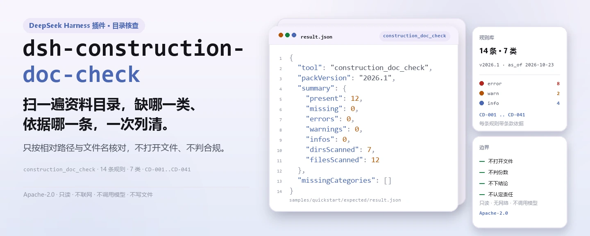
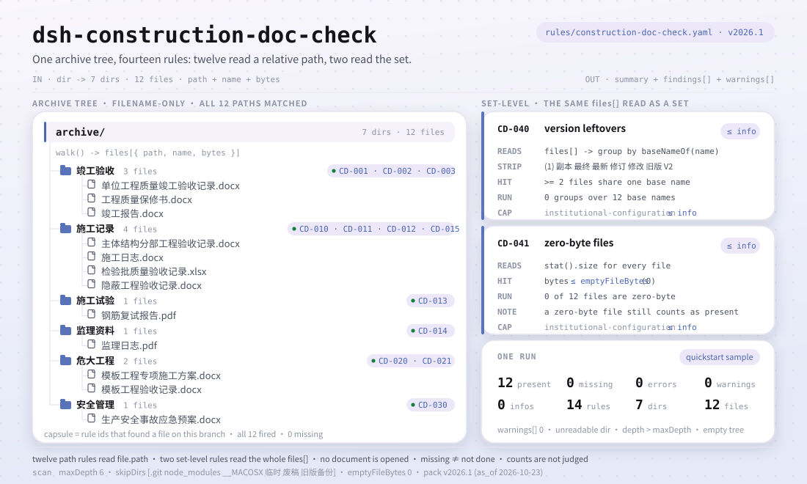

<div align="center">

<picture>
  <source media="(prefers-color-scheme: dark)" srcset="docs/assets/dsh-construction-doc-check-hero-zh-dark.webp">
  
</picture>

# dsh-construction-doc-check

**扫一遍施工资料目录，拿到「缺哪一类资料、依据哪一条」的清单——结论留给资料员与监理。**

面向 DeepSeek Harness 的目录型核查插件：按相对路径与文件名核对 12 类规定资料，外加 4 条集合级检查（版本残留、零字节文件、PDF 文本层、正文日期），只列归档内部能逐条指认的差异；默认只按文件名，开启 content 后额外读取 PDF 文本层、不判合规、不认定责任。

[安装](#三步上手) · [配置](#配置) · [FAQ](#faq) · [简体中文](README.md) · [English](README.en.md)

[](LICENSE)
[](#兼容性)
[](https://www.npmjs.com/package/dsh-construction-doc-check)
[](https://github.com/PerryLink/dsh-construction-doc-check/actions/workflows/ci.yml)
[](#兼容性)

[](https://github.com/PerryLink/dsh-construction-doc-check/stargazers)
[](https://www.npmjs.com/package/dsh-construction-doc-check)
[](https://dshfind.com/plugins/PerryLink/dsh-construction-doc-check?ref=badge)
[](https://securityscorecards.dev/viewer/?uri=github.com/PerryLink/dsh-construction-doc-check)
[](https://gitee.com/perrylink/dsh-construction-doc-check)

```sh
dsh plugin --profile <name> add dsh-construction-doc-check
```

</div>

<sub>社区插件，与 DeepSeek 官方无关。唯一仓库：<https://github.com/PerryLink/dsh-construction-doc-check>（Gitee 为镜像）。</sub>

## 它是什么

`dsh-construction-doc-check` 扫描一个施工项目的资料归档目录，按相对路径与文件名核对规则库列出的每一类资料是否存在：缺哪一类、依据哪一条、归档里哪份文件算数。它同时报告集合级问题：同一份资料出现多份（可能残留旧版本）、零字节文件（「有但用不了」）；开启 content 后还会报告 PDF 无可提取文本层（CD-043）。

它读的是文件名，不打开文件。这是刻意的上限：一个真实归档有上千份文件，先让资料员整理成表格再核对，是给资料员加活不是减活。目录和文件名是资料员已经有的东西。

- **给谁用**：施工资料员、监理、建设单位资料管理；在对话里把目录交给它即可。
- **你交什么**：一个施工项目资料文件夹的路径（只看文件名与目录结构，不读文件内容）。
- **它交什么**：一份 Markdown 缺件清单（规则号、类别、依据条款）加结构化 `resultJson`；没能执行的检查在提示里写明原因。

它回答四个问题：

- 哪些规定资料在归档里完全找不到？
- 哪些资料同时存在多个版本？
- 哪些文件是零字节，也就是「有但用不了」？
- 某条要求缺的是哪一类文件、依据哪一条？

**边界：** 三句本工具不说的话。它不打开文件，所以「有」不等于「合格」——内容由 L1/L2 层级负责。它**不判断份数**：一个分项可能要几十份检验批，本工具只判断有没有，不判断够不够。缺件说明归档无法证明做过，不等于现场没做。

<picture>
  <source media="(prefers-color-scheme: dark)" srcset="docs/assets/dsh-construction-doc-check-flow-v5-dark.svg">
  
</picture>

## 三步上手

1. **安装**（三选一）：

   ```sh
   # git 通道（最新 main；等价于 git+https://github.com/PerryLink/dsh-construction-doc-check.git）
   dsh plugin --profile <name> add github:PerryLink/dsh-construction-doc-check
   # npm 通道（已发布版本）
   dsh plugin --profile <name> add dsh-construction-doc-check
   # tarball 通道：本仓库 pnpm pack 后
   dsh plugin --profile <name> add ./dsh-construction-doc-check-<version>.tgz
   ```

2. **最小配置**（默认即可用；bundle 行不带 `config` 时全部走默认值，规则库指向随包的 `rules/construction-doc-check.yaml`）：

   ```yaml
   - insert:
       - id: dsh-construction-doc-check
         name: dsh-construction-doc-check
   ```

3. **验证已生效**：先构建（`main` 指向 `lib/index.mjs`，仓库不提交构建产物），再跑仓内自带样例：

   ```sh
   dsh --profile <name> --dump-config | grep 'dsh-construction-doc-check'
   pnpm install && pnpm run build
   node samples/quickstart/run.mjs --check
   # construction_doc_check: quickstart OK — output matches expected/result.json
   ```

   样例输出（对应 `samples/quickstart/expected/result.json`）：

   ```text
   construction_doc_check: 12 present, 0 missing — 0 error, 0 warn, 0 info (12 files, 7 dirs)
   ```

**卸载**：`dsh plugin --profile <name> remove dsh-construction-doc-check`（或从 profile patch 删掉该行）。

## 核心能力

`dsh-construction-doc-check` 注册 `construction_doc_check` 工具：传入资料归档目录，套用随包的版本化规则库，返回一份报告。

- **14 条规则一包带走** —— 规则库是数据不是代码（`rules/construction-doc-check.yaml`，版本 `2026.1`，基准日 `2026-10-23`），换掉规则库即换掉整套检查，不动一行 TypeScript。
- **按相对路径匹配，文件夹算数** —— 真实归档按文件夹分类（`危大工程/模板工程验收记录.docx`），所以匹配的是相对路径，不只看文件名。
- **三条集合级检查** —— `CD-040` 报同一份资料在归档里出现多份（含 `(1)`、`副本`、`最终`、`最新`、`修订`、`修改`、`旧版`、`V2` 等版本标记），`CD-041` 报零字节文件，`CD-043` 在 `content: true` 时报告 PDF 无可提取文本层，`CD-044` 报告正文样本找不到版本/日期标记。
- **零字节文件仍算「有」** —— 缺件与「有但用不了」分开报告：「有一份文件」与「这份文件可用」是两个判断，报告把两句都写上。
- **引文不造假** —— 每条规则带 `document` / `number` / `clause` / `excerpt` / `kind` / `source`；`excerpt` 必须是逐字引文，`check:citations` 逐条核对 `rules/evidence/clauses.md`。
- **严重级跟着证据走** —— `derived-from-principle` 最高 `warn`（`CD-014`），`institutional-configuration` 最高 `info`（`CD-015`、`CD-030`、`CD-040`、`CD-041`），并有测试断言。
- **只读、无网络、不调用模型** —— 纯 ESM，只做目录遍历、文件名正则与文件大小读取；工具参数为 `dir` / `rulePackFile` / `maxDepth`。
- **扫描不是静默的** —— 读不了的目录、超过深度上限、空目录都会进 `warnings`；报告在列结论之前先声明自己的范围。

### 示例

仓内自带样例的期望输出（由 `samples/quickstart/run.mjs` 汇总，对应 `samples/quickstart/expected/result.json`）：

```json
{
  "tool": "construction_doc_check",
  "packVersion": "2026.1",
  "summary": {
    "present": 12,
    "missing": 0,
    "errors": 0,
    "warnings": 0,
    "infos": 0,
    "dirsScanned": 7,
    "filesScanned": 12
  },
  "missingCategories": []
}
```

*Observed from `samples/quickstart/expected/result.json`*

## 依据的标准

| 文件 | 文号 | 引用它的规则 |
|---|---|---|
| 《建筑工程施工质量验收统一标准》 | GB 50300-2013 | CD-001, CD-010, CD-011, CD-012 |
| 《建设工程质量管理条例》 | 国务院令第279号 | CD-002, CD-003, CD-013 |
| 《危险性较大的分部分项工程安全管理规定》 | 住房城乡建设部令第37号 | CD-020, CD-021 |
| 房屋建筑工程施工旁站监理管理办法（试行） | 建市〔2002〕189号 | CD-014 |
| 本机构资料归档办法（本机构配置） | 无统一标准 | CD-015, CD-030, CD-040, CD-041 |

**边界：** 本插件核对的是**施工资料归档目录**的齐备性——每一类规定资料能否按相对路径找到，是否出现多份（可能残留旧版本），是否有零字节文件。默认不打开文件；开启 `content` 后只读取 PDF 文本层并报告 CD-043，仍不判断填写是否合格、份数够不够，也不认定责任。缺件只说明归档无法证明，不等于现场没做。

> **`excerpt` 的状态逐条不同，不是统一的。** 九条规则逐字引用条文（`kind: direct`）；`CD-014` 按条文原则推导（`kind: derived-from-principle`，最高 `warn`）；`CD-015`、`CD-030`、`CD-040`、`CD-041` 的阈值来自本机构归档办法（`kind: institutional-configuration`，最高 `info`），`excerpt` 如实写明「不属于国家标准条款」。`check:citations` 要求每条 `excerpt` 都能在 `rules/evidence/clauses.md` 里逐字找到，夸大依据的规则库会在门禁上失败。
>
> 结论性判断留给审核人：本插件只列出材料内部可以逐条指认的差异，不判断事实真伪，也不评价合规性。

## 配置

`src/config.ts` 里的 Schemastery `Config` 字段（可从 cordis.yml 覆盖）。按 id 覆盖会替换整行——请重述所有需要的键。

| 键 | 类型 | 默认值 | 说明 |
|---|---|---|---|
| `rulePackFile` | string | `rules/construction-doc-check.yaml` | 规则库文件路径，相对插件包根目录；也可传绝对路径 |
| `timeoutMs` | number | `120000` | 工具协作式超时预算（毫秒） |

规则库自身的扫描参数（`rules/construction-doc-check.yaml` 的 `scan` 段）：

| 键 | 默认值 | 说明 |
|---|---|---|
| `maxDepth` | `6` | 递归深度上限；更深的目录通常不是资料归档目录，触到上限时报告写入提示 |
| `skipDirs` | `['.git', 'node_modules', '__MACOSX', '临时', '废稿', '旧版备份']` | 整个跳过的目录名 |
| `emptyFileBytes` | `0` | 视为「空文件」的字节上限 |

profile patch 覆盖示例：

```yaml
- insert:
    - id: dsh-construction-doc-check
      name: dsh-construction-doc-check
      config:
        rulePackFile: rules/construction-doc-check.yaml
        timeoutMs: 180000
```

工具调用时还可以用 `dir` 指定目录、用 `maxDepth` 单次覆盖深度上限；这两个参数不写进 profile。

## 材料格式

材料是一个目录，工具不打开文件。目录里按文件夹分类，匹配对象是**相对路径**：`危大工程/模板工程验收记录.docx` 这类路径同样能命中危大工程相关规则。扩展名不参与判断，规则库只看路径里的关键词。

规则库的每条规则声明要匹配什么：

```yaml
- id: CD-020
  title: 危大工程应有专项施工方案
  category: 危大工程
  severity: error
  patterns: [专项施工方案]
```

规则库头部还有扫描参数：`scan.skipDirs` 里的目录整棵跳过（`.git`、`node_modules`、`旧版备份` 等），递归深度上限 `scan.maxDepth`（默认 6）；触到上限时报告在提示里写明未继续扫描的目录，不会假装扫完了。`emptyFileBytes`（默认 0）决定多大的文件算「空」。

## 规则来源

规则数据在 `rules/construction-doc-check.yaml`，与代码分离：每条规则带文件名、文号、按原文自身编号体系的条款号、逐字摘录与来源地址。逐字引文同时收录在 `rules/evidence/clauses.md`，`check:citations`（`node scripts/check-citations.mjs`）逐条核对：新出现的不可溯源片段会让门禁失败，基线只能收缩不能增长。

已知限制：匹配按名称，命名正确但内容错误的文件会被算作「有」；不判断份数——那需要分项明细（L1 层）；深度上限之下的深层归档可能把存在的文件报成缺件，触到上限时报告写明。

## FAQ

<details>
<summary>它会打开文件、替我判断资料填得对不对吗？</summary>

不会。它只遍历目录、读文件名与文件大小，不打开任何文档、不解析内容。命名正确但内容错误的文件同样算「有」——内容正确性由 L1/L2 层级负责，本工具是 L0。

</details>

<details>
<summary>缺件是不是说明现场没做？</summary>

不是。缺件只说明归档无法证明这项做过。报告与消息都按这个口径写，不认定责任、不判合规；补齐资料或补充说明即可。

</details>

<details>
<summary>它能判断份数够不够吗？</summary>

不能。一个分项可能要几十份检验批记录，本工具只判断「有没有」，不判断「够不够」。份数判断需要分项明细，属于 L1 层。

</details>

<details>
<summary>归档很深，会不会漏扫？</summary>

默认递归 6 层，触到上限时报告在提示里列出未继续扫描的目录，不会静默跳过。可以在规则库里调 `scan.maxDepth`，或在工具调用时传 `maxDepth` 单次覆盖。

</details>

<details>
<summary>数据会外发吗？性能开销多大？</summary>

不会。纯本地目录遍历与文件名正则，无网络请求、不调用模型，也不写任何文件。开销与目录里的文件数成正比；`timeoutMs`（默认 120 秒）是协作式超时预算。

</details>

## 排障

- **插件装上了但工具不出现**：确认 `main` 解析到 `lib/index.mjs`，且 `pnpm run build` 已产出该文件；`main` 写错会让加载器静默跳过该条目。
- **`dsh plugin add` 以不兼容为由拒绝安装**：peer 范围覆盖 `>=0.1.2-rc.1 <0.2.0` 与 `>=0.2.0-0 <0.3.0` 两条宿主线；若运行时在其之外，可显式豁免或在 profile 里固定宿主版本。
- **某条规则没有执行**：读工具结果里的 `warnings` 与报告末尾的「提示」段；目录不可读、深度超限、空目录都会在那里写明。
- **缺件清单里出现了明明在归档里的资料**：确认它在该目录的 6 层以内，且所在文件夹没有被 `skipDirs` 跳过；必要时调大 `maxDepth`。
- **找不到规则库**：报错会列出所有尝试过的路径；`rulePackFile` 相对插件包根目录解析，也可传绝对路径。

## 兼容性

| 项目 | 状态 |
|---|---|
| Harness | 对等版本范围 `>=0.1.2-rc.1 <0.2.0 \|\| >=0.2.0-0 <0.3.0`；已声明 `engines.dsh`：`>=0.2.1-0 <0.3.0` |
| Node | `^22.19.0 \|\| >=24.0.0` |
| 平台 | 全平台（纯 ESM；无原生代码、无联网、不调用模型） |

## 生态与质量

- [Gitee 镜像](https://gitee.com/perrylink/dsh-construction-doc-check)（同步镜像，以 GitHub 为准）
- [dshfind 插件页](https://dshfind.com/plugins/PerryLink/dsh-construction-doc-check)（安装量与排名）
- [OpenSSF Scorecard 报告](https://securityscorecards.dev/viewer/?uri=github.com/PerryLink/dsh-construction-doc-check)（由 [.github/workflows/scorecard.yml](.github/workflows/scorecard.yml) 驱动）
- [生态实测知识库](https://perrylink.github.io/dsh-plugin-guide/)：插件开发指南 · 选型实测数据 · 维护取舍判据

## 开发

```sh
pnpm install                                        # node ^22.19 || >=24
pnpm run typecheck                                  # tsc --noEmit
pnpm test                                           # vitest：规则夹具 + 边界语义
pnpm run build                                      # tsdown -> lib/index.mjs + lib/index.d.mts
pnpm run verify:self-contained                      # 依赖 spec 均来自 registry
pnpm run check:lockfile                             # lockfile 漂移检查
pnpm run check:readmes                              # 五语 README 一致性
pnpm run check:citations                            # 规则包引文基线
node ../scripts/sync-shared.mjs dsh-construction-doc-check   # 从 ../_shared 刷新 src/shared
pnpm pack                                           # 发布 tarball
```

本地样例试跑（需先 `pnpm run build` 产出 `lib/`）：

```sh
node samples/quickstart/run.mjs --check
# construction_doc_check: quickstart OK — output matches expected/result.json
```

目录布局：

| 路径 | 作用 |
|---|---|
| `src/index.ts` | 函数插件契约：注册 `construction_doc_check`，解析随包规则库 |
| `src/config.ts` | Schemastery 配置（`rulePackFile` / `timeoutMs`） |
| `src/engine.ts` | 纯检查核心：目录遍历、规则匹配、报告数据 |
| `src/report.ts` | Markdown 报告与 JSON 结果 |
| `src/shared/` | 共享套件（规则库读取、YAML 子集、措辞守卫、表格工具） |
| `rules/` | 规则库与 `evidence/` 条款核验记录 |
| `samples/quickstart/` | 自带样例、期望输出与试跑脚本 |
| `tests/` | vitest：每条规则配套夹具 |

README 配图由 [`scripts/gen-readme-assets.py`](scripts/gen-readme-assets.py) 程序化生成——hero 横幅用 Pillow（zh/en × 深浅共四张），结构图用手写 SVG（flow-v5 深浅两版）——可重复执行；旧的单版流程图、hero 与演示图保留在 `docs/assets/` 供外链使用，README 只引用新生成的 hero 与 flow-v5。

Topics：`deepseek-harness`, `dsh`, `dsh-plugin`, `cordis`, `construction`, `archive`, `documents`, `completion`

## 家族与致谢

本项目是 [PerryLink](https://github.com/PerryLink) 维护的 DeepSeek Harness 插件家族成员（全部 Apache-2.0）。完整家族索引见[按材料选核查器](https://perrylink.github.io/zh/checkers/choose/)与[全部插件](https://github.com/PerryLink)。如果这个插件帮到了你，**给个 star**——它不解锁任何功能，但会让下一个人更容易找到它。

- [@PerryLink](https://github.com/PerryLink) —— 创建者与维护者：目录型规则库（CD-001..CD-041）、`construction_doc_check` 工具、引文核验记录与五语文档。

<details>
<summary>展开全部插件</summary>

| 插件 | 状态 |
|---|---|
| **[dsh-aqua-input-check](https://github.com/PerryLink/dsh-aqua-input-check)** |  |
| **[dsh-archive-check](https://github.com/PerryLink/dsh-archive-check)** |  |
| **[dsh-auto-review](https://github.com/PerryLink/dsh-auto-review)** |  |
| **[dsh-autotier](https://github.com/PerryLink/dsh-autotier)** | 🧊 已冻结 — 见仓库 README |
| **[dsh-bid-ca-precheck](https://github.com/PerryLink/dsh-bid-ca-precheck)** |  |
| **[dsh-bid-qual-check](https://github.com/PerryLink/dsh-bid-qual-check)** |  |
| **[dsh-cert-mcp](https://github.com/PerryLink/dsh-cert-mcp)** | 🧊 已冻结 — 见仓库 README |
| **[dsh-checkpoint-rewind](https://github.com/PerryLink/dsh-checkpoint-rewind)** |  |
| **[dsh-click](https://github.com/PerryLink/dsh-click)** |  |
| **[dsh-composer-history](https://github.com/PerryLink/dsh-composer-history)** |  |
| **[dsh-contract-stance](https://github.com/PerryLink/dsh-contract-stance)** |  |
| **[dsh-customs-doc-check](https://github.com/PerryLink/dsh-customs-doc-check)** |  |
| **[dsh-data-quality](https://github.com/PerryLink/dsh-data-quality)** | 🧊 已冻结 — 见仓库 README |
| **[dsh-demurrage-ledger](https://github.com/PerryLink/dsh-demurrage-ledger)** |  |
| **[dsh-doublecheck](https://github.com/PerryLink/dsh-doublecheck)** |  |
| **[dsh-drill-script-check](https://github.com/PerryLink/dsh-drill-script-check)** |  |
| **[dsh-eia-guide-check](https://github.com/PerryLink/dsh-eia-guide-check)** |  |
| **[dsh-emergency-plan](https://github.com/PerryLink/dsh-emergency-plan)** |  |
| **[dsh-essay-rubric-check](https://github.com/PerryLink/dsh-essay-rubric-check)** |  |
| **[dsh-evidence-check](https://github.com/PerryLink/dsh-evidence-check)** |  |
| **[dsh-export-ctl-check](https://github.com/PerryLink/dsh-export-ctl-check)** |  |
| **[dsh-fast](https://github.com/PerryLink/dsh-fast)** |  |
| **[dsh-fmea-table-check](https://github.com/PerryLink/dsh-fmea-table-check)** |  |
| **[dsh-forecast-penalty](https://github.com/PerryLink/dsh-forecast-penalty)** |  |
| **[dsh-fund-research](https://github.com/PerryLink/dsh-fund-research)** |  |
| **[dsh-github](https://github.com/PerryLink/dsh-github)** |  |
| **[dsh-gongwen-flow-check](https://github.com/PerryLink/dsh-gongwen-flow-check)** |  |
| **[dsh-gongwen-word-check](https://github.com/PerryLink/dsh-gongwen-word-check)** |  |
| **[dsh-guard-plan-qc](https://github.com/PerryLink/dsh-guard-plan-qc)** |  |
| **[dsh-hazchem-check](https://github.com/PerryLink/dsh-hazchem-check)** |  |
| **[dsh-hazplan-check](https://github.com/PerryLink/dsh-hazplan-check)** |  |
| **[dsh-hidden-risk-map](https://github.com/PerryLink/dsh-hidden-risk-map)** |  |
| **[dsh-hs-classify](https://github.com/PerryLink/dsh-hs-classify)** |  |
| **[dsh-icd-rule-check](https://github.com/PerryLink/dsh-icd-rule-check)** |  |
| **[dsh-industry-research](https://github.com/PerryLink/dsh-industry-research)** |  |
| **[dsh-lawcite-adapter](https://github.com/PerryLink/dsh-lawcite-adapter)** |  |
| **[dsh-laya](https://github.com/PerryLink/dsh-laya)** |  |
| **[dsh-lc-doc-check](https://github.com/PerryLink/dsh-lc-doc-check)** |  |
| **[dsh-learning-gap-check](https://github.com/PerryLink/dsh-learning-gap-check)** |  |
| **[dsh-library](https://github.com/PerryLink/dsh-library)** |  |
| **[dsh-local-ai](https://github.com/PerryLink/dsh-local-ai)** |  |
| **[dsh-lsp-actions](https://github.com/PerryLink/dsh-lsp-actions)** |  |
| **[dsh-mask](https://github.com/PerryLink/dsh-mask)** |  |
| **[dsh-mcp-panel](https://github.com/PerryLink/dsh-mcp-panel)** |  |
| **[dsh-medrec-qc](https://github.com/PerryLink/dsh-medrec-qc)** |  |
| **[dsh-memento](https://github.com/PerryLink/dsh-memento)** | 🧊 已冻结 — 见仓库 README |
| **[dsh-nsfc-form-check](https://github.com/PerryLink/dsh-nsfc-form-check)** |  |
| **[dsh-nurse-record-check](https://github.com/PerryLink/dsh-nurse-record-check)** |  |
| **[dsh-observe](https://github.com/PerryLink/dsh-observe)** |  |
| **[dsh-origin-rvc-check](https://github.com/PerryLink/dsh-origin-rvc-check)** |  |
| **[dsh-ota-review-check](https://github.com/PerryLink/dsh-ota-review-check)** |  |
| **[dsh-output-styles](https://github.com/PerryLink/dsh-output-styles)** |  |
| **[dsh-paper-doc-adapter](https://github.com/PerryLink/dsh-paper-doc-adapter)** |  |
| **[dsh-permission-rules](https://github.com/PerryLink/dsh-permission-rules)** |  |
| **[dsh-permit-report-check](https://github.com/PerryLink/dsh-permit-report-check)** |  |
| **[dsh-pipeline-check](https://github.com/PerryLink/dsh-pipeline-check)** |  |
| **[dsh-pleading-draft](https://github.com/PerryLink/dsh-pleading-draft)** |  |
| **[dsh-plugin-doctor](https://github.com/PerryLink/dsh-plugin-doctor)** | 🚫 已退役（仓库已归档） |
| **[dsh-plugin-guide](https://github.com/PerryLink/dsh-plugin-guide)** |  |
| **[dsh-plugin-kit](https://github.com/PerryLink/dsh-plugin-kit)** | 🚫 已退役（仓库已归档） |
| **[dsh-plugin-upgrade](https://github.com/PerryLink/dsh-plugin-upgrade)** | 🚫 已退役（仓库已归档） |
| **[dsh-policy-brief-draft](https://github.com/PerryLink/dsh-policy-brief-draft)** |  |
| **[dsh-power-loss-split](https://github.com/PerryLink/dsh-power-loss-split)** |  |
| **[dsh-power-ticket-check](https://github.com/PerryLink/dsh-power-ticket-check)** |  |
| **[dsh-ppap-check](https://github.com/PerryLink/dsh-ppap-check)** |  |
| **[dsh-protest-deadline](https://github.com/PerryLink/dsh-protest-deadline)** |  |
| **[dsh-railway-window](https://github.com/PerryLink/dsh-railway-window)** |  |
| **[dsh-repair-order-qc](https://github.com/PerryLink/dsh-repair-order-qc)** |  |
| **[dsh-research-report](https://github.com/PerryLink/dsh-research-report)** |  |
| **[dsh-review-reply-check](https://github.com/PerryLink/dsh-review-reply-check)** |  |
| **[dsh-rulefile-check](https://github.com/PerryLink/dsh-rulefile-check)** |  |
| **[dsh-safety-brief-check](https://github.com/PerryLink/dsh-safety-brief-check)** |  |
| **[dsh-score](https://github.com/PerryLink/dsh-score)** | 🧊 已冻结 — 见仓库 README |
| **[dsh-session-sync](https://github.com/PerryLink/dsh-session-sync)** |  |
| **[dsh-site-log-check](https://github.com/PerryLink/dsh-site-log-check)** |  |
| **[dsh-skill-pack-security](https://github.com/PerryLink/dsh-skill-pack-security)** |  |
| **[dsh-soe-decision-check](https://github.com/PerryLink/dsh-soe-decision-check)** |  |
| **[dsh-soilwater-check](https://github.com/PerryLink/dsh-soilwater-check)** |  |
| **[dsh-sop-sync-check](https://github.com/PerryLink/dsh-sop-sync-check)** |  |
| **[dsh-spc-gbt-adapter](https://github.com/PerryLink/dsh-spc-gbt-adapter)** |  |
| **[dsh-talk](https://github.com/PerryLink/dsh-talk)** |  |
| **[dsh-tender-extract](https://github.com/PerryLink/dsh-tender-extract)** |  |
| **[dsh-tender-matrix](https://github.com/PerryLink/dsh-tender-matrix)** |  |
| **[dsh-test-drive](https://github.com/PerryLink/dsh-test-drive)** |  |
| **[dsh-ticktick](https://github.com/PerryLink/dsh-ticktick)** | 🚫 已退役（仓库已归档） |
| **[dsh-translate](https://github.com/PerryLink/dsh-translate)** |  |
| **[dsh-warranty-calc](https://github.com/PerryLink/dsh-warranty-calc)** |  |
| **[dsh-budget](https://github.com/PerryLink/dsh-budget)** | 🧊 已冻结 — 见仓库 README |
| **[dsh-claude-move](https://github.com/PerryLink/dsh-claude-move)** | 🧊 已冻结 — 见仓库 README |
| **[dsh-defend](https://github.com/PerryLink/dsh-defend)** | 🧊 已冻结 — 见仓库 README |
| **[dsh-draw](https://github.com/PerryLink/dsh-draw)** | 🧊 已冻结 — 见仓库 README |
| **[dsh-reach](https://github.com/PerryLink/dsh-reach)** | 🧊 已冻结 — 见仓库 README |
| **[dsh-background-agents](https://github.com/PerryLink/dsh-background-agents)** | 🚫 已退役（仓库已归档） |
| **[dsh-session-pin](https://github.com/PerryLink/dsh-session-pin)** | 🚫 已退役（仓库已归档） |
| **[dsh-team-rooms](https://github.com/PerryLink/dsh-team-rooms)** | 🚫 已退役（仓库已归档） |

</details>

## License

[LICENSE](LICENSE)（Apache License 2.0）© 2026 dsh-construction-doc-check contributors

<p align="center"><sub>Apache-2.0 · 社区插件，与 DeepSeek 无关。</sub></p>
