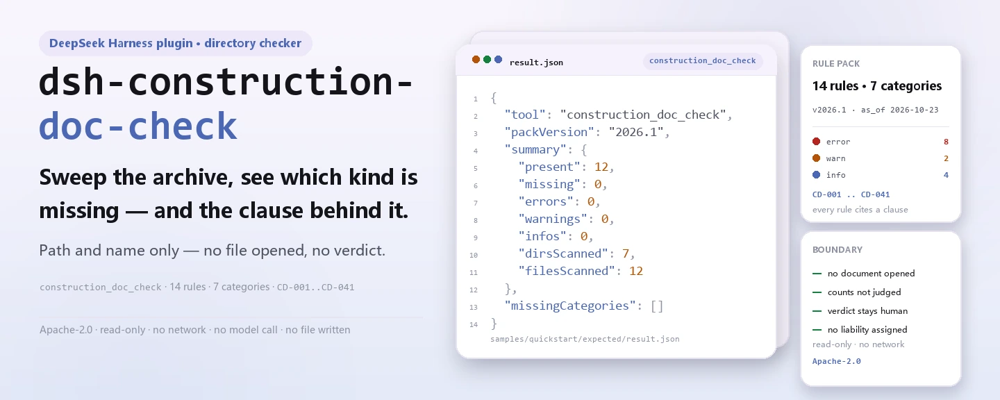
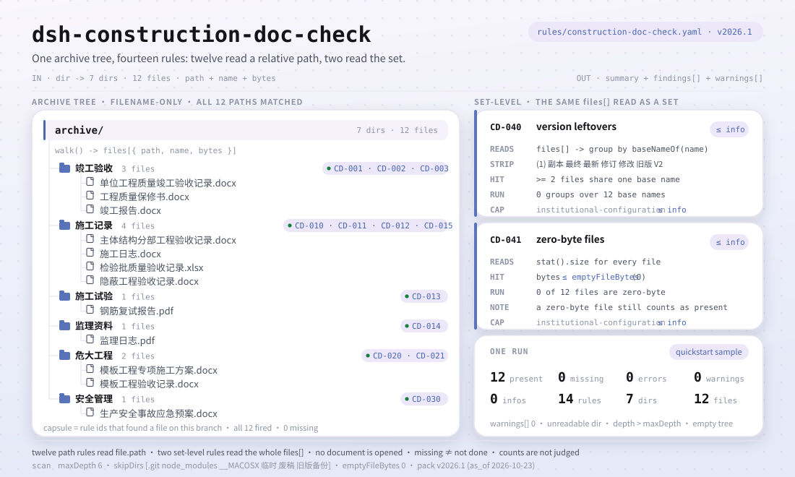

<div align="center">

<picture>
  <source media="(prefers-color-scheme: dark)" srcset="docs/assets/dsh-construction-doc-check-hero-en-dark.webp">
  
</picture>

# dsh-construction-doc-check

**Percorre o arquivo documental de uma obra e devolve a lista de que documento exigido falta e que cláusula o exige — o veredito fica com o responsável documental e o fiscal.**

Um plugin verificador de pastas para o DeepSeek Harness: confirma 12 tipos de documento exigidos pelo caminho relativo e pelo nome do ficheiro, acrescenta duas verificações de conjunto (revisões residuais, ficheiros de zero bytes) e lista apenas as diferenças que consegue apontar dentro do arquivo — nunca abre um documento, decide conformidade nem atribui responsabilidade.

[Instalar](#instalação-em-três-passos) · [Configuração](#configuração) · [FAQ](#faq) · [简体中文](README.md) · [English](README.en.md) · [Español](README.es.md) · [Português](README.pt.md) · [हिन्दी](README.hi.md)

[](LICENSE)
[](#compatibilidade)
[](https://www.npmjs.com/package/dsh-construction-doc-check)
[](https://github.com/PerryLink/dsh-construction-doc-check/actions/workflows/ci.yml)
[](#compatibilidade)

[](https://github.com/PerryLink/dsh-construction-doc-check/stargazers)
[](https://www.npmjs.com/package/dsh-construction-doc-check)
[](https://dshfind.com/plugins/PerryLink/dsh-construction-doc-check?ref=badge)
[](https://securityscorecards.dev/viewer/?uri=github.com/PerryLink/dsh-construction-doc-check)
[](https://gitee.com/perrylink/dsh-construction-doc-check)

```sh
dsh plugin --profile <name> add dsh-construction-doc-check
```

</div>

<sub>Plugin da comunidade, não afiliado à DeepSeek. Repositório canónico: <https://github.com/PerryLink/dsh-construction-doc-check> (o Gitee é um espelho).</sub>

## O que é

O `dsh-construction-doc-check` percorre o arquivo documental de uma obra e confirma, pelo caminho relativo e pelo nome do ficheiro, se está presente cada tipo de documento declarado no pacote de regras: o que falta, que cláusula o exige e que ficheiro do arquivo conta. Reporta também dois problemas de conjunto: um nome de documento que aparece mais do que uma vez (possíveis revisões residuais) e ficheiros de zero bytes («presente mas inutilizável»).

Lê nomes de ficheiro, não ficheiros. É um limite deliberado: um arquivo real tem mil documentos e pedir ao responsável que os transcreva antes para uma tabela dá mais trabalho, não menos. A pasta e os nomes são o que ele já tem.

- **Para quem**: responsáveis documentais de obra, fiscais e gestão documental do dono de obra; basta entregar-lhe uma pasta no chat.
- **O que lhe dás**: o caminho de uma pasta de documentação de obra (apenas nomes e estrutura de pastas, nunca o conteúdo).
- **O que devolve**: uma lista Markdown de documentos em falta (id da regra, categoria, cláusula de base) mais um `resultJson` estruturado; toda a verificação que não pôde correr explica porquê nos avisos.

Responde a quatro perguntas:

- Que tipos de documento exigidos não aparecem em parte alguma do arquivo?
- Que documentos existem em mais do que uma revisão ao mesmo tempo?
- Que ficheiros têm zero bytes e, por isso, são inutilizáveis?
- Que requisito falta e que cláusula o exige?

**Limite:** três afirmações que esta ferramenta não faz. Não abre documentos, pelo que «presente» não é «correto» — o conteúdo é uma camada posterior (L1/L2). **Não** julga **quantas** cópias deve haver de cada tipo: um item pode precisar de dezenas de registos de inspeção por lote, e isto verifica existência, não suficiência. E um ficheiro ausente significa que o arquivo não pode provar que foi feito, não que não tenha sido feito.

<picture>
  <source media="(prefers-color-scheme: dark)" srcset="docs/assets/dsh-construction-doc-check-flow-v5-dark.svg">
  
</picture>

## Instalação em três passos

1. **Instala** (escolhe um canal):

   ```sh
   # canal git (último main; equivale a git+https://github.com/PerryLink/dsh-construction-doc-check.git)
   dsh plugin --profile <name> add github:PerryLink/dsh-construction-doc-check
   # canal npm (versões publicadas)
   dsh plugin --profile <name> add dsh-construction-doc-check
   # canal tarball: pnpm pack neste repo e depois
   dsh plugin --profile <name> add ./dsh-construction-doc-check-<version>.tgz
   ```

2. **Configuração mínima** (os valores por omissão já funcionam; uma linha de bundle sem `config` usa todos os valores por omissão e aponta para o pacote incluído `rules/construction-doc-check.yaml`):

   ```yaml
   - insert:
       - id: dsh-construction-doc-check
         name: dsh-construction-doc-check
   ```

3. **Confirma que monta**: compila primeiro (`main` aponta para `lib/index.mjs`; o repositório não versiona o resultado da compilação) e corre a amostra incluída:

   ```sh
   dsh --profile <name> --dump-config | grep 'dsh-construction-doc-check'
   pnpm install && pnpm run build
   node samples/quickstart/run.mjs --check
   # construction_doc_check: quickstart OK — output matches expected/result.json
   ```

   Saída da amostra (coincide com `samples/quickstart/expected/result.json`):

   ```text
   construction_doc_check: 12 present, 0 missing — 0 error, 0 warn, 0 info (12 files, 7 dirs)
   ```

**Desinstalar**: `dsh plugin --profile <name> remove dsh-construction-doc-check` (ou remover a linha do patch do perfil).

## Capacidades principais

O `dsh-construction-doc-check` regista a ferramenta `construction_doc_check`: recebe um diretório de arquivo documental, aplica o pacote de regras versionado que inclui e devolve um relatório.

- **14 regras num pacote de dados** — o pacote de regras é dado, não código (`rules/construction-doc-check.yaml`, versão `2026.1`, com data de referência `2026-10-23`); substituí-lo troca todo o conjunto de verificações sem tocar numa linha de TypeScript.
- **Coincide com o caminho relativo, as pastas contam** — os arquivos reais classificam por pasta (por exemplo, um registo de aceitação guardado sob a pasta de obras de risco elevado), pelo que a coincidência é feita contra o caminho relativo, não apenas contra o nome.
- **Duas verificações de conjunto** — `CD-040` reporta um nome de documento que aparece mais do que uma vez no arquivo (marcas como `(1)`, `V2` ou um sufixo local para cópia, final, último, revisto ou versão antiga), e `CD-041` reporta ficheiros de zero bytes.
- **Um ficheiro de zero bytes continua a contar como presente** — um documento ausente e um inutilizável são reportados em separado: «há um ficheiro» e «o ficheiro é utilizável» são duas afirmações distintas, e o relatório faz ambas.
- **Sem citações inventadas** — cada regra leva `document` / `number` / `clause` / `excerpt` / `kind` / `source`; `excerpt` tem de ser uma citação literal, e `check:citations` verifica cada uma contra `rules/evidence/clauses.md`.
- **A severidade segue a evidência** — `derived-from-principle` fica limitado a `warn` (`CD-014`), `institutional-configuration` a `info` (`CD-015`, `CD-030`, `CD-040`, `CD-041`), e um teste garante-o.
- **Só leitura, sem rede, sem chamadas ao modelo** — ESM puro: percurso de diretórios, expressões regulares sobre nomes e leitura de tamanhos; os parâmetros da ferramenta são `dir` / `rulePackFile` / `maxDepth`.
- **A análise nunca é silenciosa** — os diretórios ilegíveis, os limites de profundidade e uma pasta vazia vão para `warnings`; o relatório declara o seu alcance antes das conclusões.

### Exemplo

Saída esperada para a amostra incluída (resumida por `samples/quickstart/run.mjs` e coincidente com `samples/quickstart/expected/result.json`):

```json
{
  "tool": "construction_doc_check",
  "packVersion": "2026.1",
  "summary": {
    "present": 12,
    "missing": 0,
    "errors": 0,
    "warnings": 0,
    "infos": 0,
    "dirsScanned": 7,
    "filesScanned": 12
  },
  "missingCategories": []
}
```

*Observed from `samples/quickstart/expected/result.json`*

## Normas que segue

| Documento | Número | Regras que o citam |
|---|---|---|
| Norma unificada de aceitação da qualidade da construção de edifícios | GB 50300-2013 | CD-001, CD-010, CD-011, CD-012 |
| Regulamento de gestão da qualidade das obras de construção | Decreto do Conselho de Estado n.º 279 | CD-002, CD-003, CD-013 |
| Disposições sobre a gestão de segurança de subobras de risco elevado | Decreto n.º 37 do Ministério da Habitação e do Desenvolvimento Urbano-Rural | CD-020, CD-021 |
| Medidas de administração da fiscalização em obra da construção de edifícios (ensaio) | Jian Shi [2002] n.º 189 | CD-014 |
| Política institucional de arquivo documental (configuração da instituição) | Sem norma unificada | CD-015, CD-030, CD-040, CD-041 |

**Limite:** este plugin verifica a completude de um **arquivo documental de obra** — se cada tipo de documento exigido é encontrado pelo caminho relativo, se um nome de documento aparece mais do que uma vez (possíveis revisões residuais) e se algum ficheiro tem zero bytes. **Não** abre ficheiros, não revê conteúdos, não julga se um formulário está bem preenchido, não julga se o número de cópias é suficiente nem atribui responsabilidade. Um documento ausente significa apenas que o arquivo não o pode provar, não que o trabalho não tenha sido feito.

> **O estado de `excerpt` é por regra, não uniforme.** Nove regras citam a cláusula literalmente (`kind: direct`); `CD-014` é derivada do princípio dos artigos citados (`kind: derived-from-principle`, limitada a `warn`); `CD-015`, `CD-030`, `CD-040` e `CD-041` tiram os seus limiares da política de arquivo da própria instituição (`kind: institutional-configuration`, limitada a `info`), e o `excerpt` diz claramente que o requisito não é uma cláusula de norma nacional. O `check:citations` exige que cada `excerpt` seja encontrado literalmente em `rules/evidence/clauses.md`; um pacote que exagere a sua base falha a porta.
>
> A conclusão é do revisor: este plugin enumera diferenças que consegue apontar dentro do material e não decide factos nem conformidade.

## Configuração

Todos os parâmetros são campos Schemastery `Config` em `src/config.ts` (alteráveis a partir do cordis.yml). Uma substituição dirigida por id substitui a linha inteira — repete todas as chaves de que precisas.

| Chave | Tipo | Valor por omissão | Descrição |
|---|---|---|---|
| `rulePackFile` | string | `rules/construction-doc-check.yaml` | Caminho do pacote de regras, relativo à raiz do pacote; também aceita um caminho absoluto |
| `timeoutMs` | number | `120000` | Orçamento de tempo limite cooperativo da ferramenta (milissegundos) |

Parâmetros de análise do próprio pacote de regras (secção `scan` de `rules/construction-doc-check.yaml`):

| Chave | Valor por omissão | Descrição |
|---|---|---|
| `maxDepth` | `6` | Limite de profundidade da recursão; as pastas mais fundas normalmente não são de arquivo, e o relatório escreve um aviso ao atingir o limite |
| `skipDirs` | `['.git', 'node_modules', '__MACOSX', …]` | Nomes de pasta ignorados por completo; o pacote incluído ignora também três nomes locais de pastas temporárias ou de cópia de segurança — consulta o pacote para a lista exata |
| `emptyFileBytes` | `0` | Limite de bytes abaixo do qual um ficheiro conta como vazio |

Exemplo de substituição no teu patch de perfil:

```yaml
- insert:
    - id: dsh-construction-doc-check
      name: dsh-construction-doc-check
      config:
        rulePackFile: rules/construction-doc-check.yaml
        timeoutMs: 180000
```

Na chamada, a ferramenta também aceita `dir` para escolher o diretório e `maxDepth` para substituir o limite de profundidade nessa chamada; nenhum dos dois vai no perfil.

## Formato do material

O material é um diretório e a ferramenta não abre ficheiros. O arquivo documental classifica por pasta, e a coincidência é feita contra o **caminho relativo**: um registo guardado um nível abaixo, por exemplo sob uma pasta de obras de risco elevado, coincide com as regras pela pasta e pelo nome. A extensão não conta: o pacote olha apenas para palavras-chave do caminho.

Cada regra do pacote declara o que procurar:

```yaml
- id: CD-020
  title: 危大工程应有专项施工方案
  category: 危大工程
  severity: error
  patterns: [专项施工方案]
```

O cabeçalho do pacote também leva os parâmetros de análise: as pastas em `scan.skipDirs` são ignoradas por inteiro (`.git`, `node_modules`, pastas locais de cópia de segurança, …) e a recursão é limitada por `scan.maxDepth` (6 por omissão); ao atingir o limite, o relatório enumera as pastas em que não entrou em vez de fingir que a análise terminou. `emptyFileBytes` (0 por omissão) decide quão pequeno tem de ser um ficheiro para contar como vazio.

## Fontes das regras

Os dados das regras vivem em `rules/construction-doc-check.yaml`, separados do código: cada regra leva nome do documento, número, cláusula segundo a numeração da própria fonte, uma citação literal e um URL de origem. As citações ficam também registadas em `rules/evidence/clauses.md`, e o `check:citations` (`node scripts/check-citations.mjs`) verifica cada uma: um novo segmento não rastreável faz falhar a porta e a linha de base só pode encolher.

Limites conhecidos: a coincidência é por nome, pelo que um documento bem nomeado mas errado conta como presente; não se julgam contagens — isso precisa do desdobramento por item (a camada L1); e um arquivo muito aninhado pode ser reportado como ausente quando está um nível abaixo do limite, o que o relatório indica ao atingi-lo.

## FAQ

<details>
<summary>Abre documentos e julga se estão bem preenchidos?</summary>

Não. Percorre diretórios e lê nomes e tamanhos de ficheiro, sem abrir qualquer documento nem analisar conteúdo. Um documento bem nomeado mas errado continua a contar como presente — a correção do conteúdo é tarefa da camada L1/L2; esta ferramenta é L0.

</details>

<details>
<summary>Um documento ausente significa que o trabalho não foi feito?</summary>

Não. Um documento ausente significa apenas que o arquivo não o pode provar. O relatório e as mensagens são redigidos assim: sem responsabilidade nem veredito de conformidade; basta completar a lacuna ou acrescentar uma nota explicativa.

</details>

<details>
<summary>Consegue dizer se o número de cópias é suficiente?</summary>

Não. Um item pode precisar de dezenas de registos de inspeção por lote, e esta ferramenta verifica existência, não suficiência. Contar exige o desdobramento por item e pertence à camada L1.

</details>

<details>
<summary>O arquivo é profundo, vai saltar alguma coisa?</summary>

Percorre 6 níveis por omissão; ao atingir o limite, o relatório enumera as pastas em que não entrou em vez de as omitir em silêncio. Podes subir `scan.maxDepth` no pacote ou passar `maxDepth` numa chamada concreta.

</details>

<details>
<summary>Envia dados para algum lado? Quanto custa?</summary>

Não. Apenas percurso local de diretórios e expressões regulares sobre nomes: sem pedidos de rede, sem chamadas ao modelo e sem escrever ficheiros. O custo cresce com o número de ficheiros do arquivo; `timeoutMs` (120 s por omissão) é o orçamento de tempo limite cooperativo.

</details>

## Resolução de problemas

- **O plugin instala mas a ferramenta não aparece**: confirma que `main` resolve para `lib/index.mjs` e que `pnpm run build` o produziu; um `main` errado faz o carregador ignorar a entrada em silêncio.
- **O `dsh plugin add` rejeita o pacote**: o intervalo de peers cobre as linhas de anfitrião `>=0.1.2-rc.1 <0.2.0` e `>=0.2.0-0 <0.3.0`; fora delas, concede uma isenção explícita ou fixa a versão do anfitrião no perfil.
- **Uma regra não correu**: lê os `warnings` do resultado da ferramenta e o bloco de avisos no fim do relatório; diretórios ilegíveis, limites de profundidade e uma pasta vazia ficam registados ali.
- **A lista de faltas nomeia um documento que está no arquivo**: confirma que está dentro de seis níveis e que a pasta não está em `skipDirs`; sobe `maxDepth` se for preciso.
- **Não se encontra o pacote de regras**: o erro enumera todos os caminhos tentados; `rulePackFile` resolve contra a raiz do pacote e também aceita um caminho absoluto.

## Compatibilidade

| Superfície | Estado |
|---|---|
| Harness | intervalo de peers `>=0.1.2-rc.1 <0.2.0 \|\| >=0.2.0-0 <0.3.0`; `engines.dsh` declarado como `>=0.2.1-0 <0.3.0` |
| Node | `^22.19.0 \|\| >=24.0.0` |
| Plataformas | todas (ESM puro; sem código nativo, sem rede, sem chamadas ao modelo) |

## Ecossistema e qualidade

- [Espelho no Gitee](https://gitee.com/perrylink/dsh-construction-doc-check) (espelho sincronizado; o GitHub é canónico)
- [Página do plugin no dshfind](https://dshfind.com/plugins/PerryLink/dsh-construction-doc-check) (instalações e ranking)
- [Relatório OpenSSF Scorecard](https://securityscorecards.dev/viewer/?uri=github.com/PerryLink/dsh-construction-doc-check) (gerado por [.github/workflows/scorecard.yml](.github/workflows/scorecard.yml))
- [Base de conhecimento do ecossistema](https://perrylink.github.io/dsh-plugin-guide/): guia de desenvolvimento de plugins · dados de seleção · critérios de manutenção

## Desenvolvimento

```sh
pnpm install                                        # node ^22.19 || >=24
pnpm run typecheck                                  # tsc --noEmit
pnpm test                                           # vitest: fixtures por regra + semântica de fronteira
pnpm run build                                      # tsdown -> lib/index.mjs + lib/index.d.mts
pnpm run verify:self-contained                      # as dependências resolvem a partir do registry
pnpm run check:lockfile                             # verificação de deriva do lockfile
pnpm run check:readmes                              # consistência dos README em cinco idiomas
pnpm run check:citations                            # linha de base de citações do pacote de regras
node ../scripts/sync-shared.mjs dsh-construction-doc-check   # atualiza src/shared a partir de ../_shared
pnpm pack                                           # o tarball publicado
```

Execução local da amostra (compila antes para que `lib/` exista):

```sh
node samples/quickstart/run.mjs --check
# construction_doc_check: quickstart OK — output matches expected/result.json
```

Estrutura do diretório:

| Caminho | Função |
|---|---|
| `src/index.ts` | contrato de plugin de função: regista `construction_doc_check` e resolve o pacote de regras incluído |
| `src/config.ts` | configuração Schemastery (`rulePackFile` / `timeoutMs`) |
| `src/engine.ts` | núcleo de verificação puro: percurso, correspondência de regras, dados do relatório |
| `src/report.ts` | relatório Markdown e resultado JSON |
| `src/shared/` | kit partilhado (leitor do pacote de regras, subconjunto YAML, guarda de redação, utilitários de tabela) |
| `rules/` | pacote de regras e registo de verificação de cláusulas em `evidence/` |
| `samples/quickstart/` | amostra incluída, saída esperada e script de execução |
| `tests/` | vitest: um fixture emparelhado por regra |

As imagens do README são geradas programaticamente por [`scripts/gen-readme-assets.py`](scripts/gen-readme-assets.py) — o hero com Pillow (zh/en × claro/escuro, quatro WebP) e a figura de estrutura como SVG escrito à mão (flow-v5, claro/escuro) — e podem ser executadas de novo; o diagrama de fluxo, o hero e a demo de uma só versão ficam em `docs/assets/` para ligações externas, e os README referenciam apenas o novo hero e o par flow-v5.

Topics: `deepseek-harness`, `dsh`, `dsh-plugin`, `cordis`, `construction`, `archive`, `documents`, `completion`

## Família e agradecimentos

Este projeto faz parte da família de plugins do DeepSeek Harness da [PerryLink](https://github.com/PerryLink) (todos Apache-2.0). Índice completo: [escolhe um verificador por material](https://perrylink.github.io/zh/checkers/choose/) e [todos os plugins](https://github.com/PerryLink). Se te for útil, **uma estrela ajuda a próxima pessoa a encontrá-lo** — não desbloqueia nada.

- [@PerryLink](https://github.com/PerryLink) — criador e mantenedor: o pacote de regras de pastas (CD-001..CD-041), a ferramenta `construction_doc_check`, o registo de verificação de citações e a documentação em cinco idiomas.

<details>
<summary>Ver todos os plugins</summary>

| Plugin | Estado |
|---|---|
| **[dsh-aqua-input-check](https://github.com/PerryLink/dsh-aqua-input-check)** |  |
| **[dsh-archive-check](https://github.com/PerryLink/dsh-archive-check)** |  |
| **[dsh-auto-review](https://github.com/PerryLink/dsh-auto-review)** |  |
| **[dsh-autotier](https://github.com/PerryLink/dsh-autotier)** | 🧊 CONGELADO — ver o README do repo |
| **[dsh-bid-ca-precheck](https://github.com/PerryLink/dsh-bid-ca-precheck)** |  |
| **[dsh-bid-qual-check](https://github.com/PerryLink/dsh-bid-qual-check)** |  |
| **[dsh-cert-mcp](https://github.com/PerryLink/dsh-cert-mcp)** | 🧊 CONGELADO — ver o README do repo |
| **[dsh-checkpoint-rewind](https://github.com/PerryLink/dsh-checkpoint-rewind)** |  |
| **[dsh-click](https://github.com/PerryLink/dsh-click)** |  |
| **[dsh-composer-history](https://github.com/PerryLink/dsh-composer-history)** |  |
| **[dsh-contract-stance](https://github.com/PerryLink/dsh-contract-stance)** |  |
| **[dsh-customs-doc-check](https://github.com/PerryLink/dsh-customs-doc-check)** |  |
| **[dsh-data-quality](https://github.com/PerryLink/dsh-data-quality)** | 🧊 CONGELADO — ver o README do repo |
| **[dsh-demurrage-ledger](https://github.com/PerryLink/dsh-demurrage-ledger)** |  |
| **[dsh-doublecheck](https://github.com/PerryLink/dsh-doublecheck)** |  |
| **[dsh-drill-script-check](https://github.com/PerryLink/dsh-drill-script-check)** |  |
| **[dsh-eia-guide-check](https://github.com/PerryLink/dsh-eia-guide-check)** |  |
| **[dsh-emergency-plan](https://github.com/PerryLink/dsh-emergency-plan)** |  |
| **[dsh-essay-rubric-check](https://github.com/PerryLink/dsh-essay-rubric-check)** |  |
| **[dsh-evidence-check](https://github.com/PerryLink/dsh-evidence-check)** |  |
| **[dsh-export-ctl-check](https://github.com/PerryLink/dsh-export-ctl-check)** |  |
| **[dsh-fast](https://github.com/PerryLink/dsh-fast)** |  |
| **[dsh-fmea-table-check](https://github.com/PerryLink/dsh-fmea-table-check)** |  |
| **[dsh-forecast-penalty](https://github.com/PerryLink/dsh-forecast-penalty)** |  |
| **[dsh-fund-research](https://github.com/PerryLink/dsh-fund-research)** |  |
| **[dsh-github](https://github.com/PerryLink/dsh-github)** |  |
| **[dsh-gongwen-flow-check](https://github.com/PerryLink/dsh-gongwen-flow-check)** |  |
| **[dsh-gongwen-word-check](https://github.com/PerryLink/dsh-gongwen-word-check)** |  |
| **[dsh-guard-plan-qc](https://github.com/PerryLink/dsh-guard-plan-qc)** |  |
| **[dsh-hazchem-check](https://github.com/PerryLink/dsh-hazchem-check)** |  |
| **[dsh-hazplan-check](https://github.com/PerryLink/dsh-hazplan-check)** |  |
| **[dsh-hidden-risk-map](https://github.com/PerryLink/dsh-hidden-risk-map)** |  |
| **[dsh-hs-classify](https://github.com/PerryLink/dsh-hs-classify)** |  |
| **[dsh-icd-rule-check](https://github.com/PerryLink/dsh-icd-rule-check)** |  |
| **[dsh-industry-research](https://github.com/PerryLink/dsh-industry-research)** |  |
| **[dsh-lawcite-adapter](https://github.com/PerryLink/dsh-lawcite-adapter)** |  |
| **[dsh-laya](https://github.com/PerryLink/dsh-laya)** |  |
| **[dsh-lc-doc-check](https://github.com/PerryLink/dsh-lc-doc-check)** |  |
| **[dsh-learning-gap-check](https://github.com/PerryLink/dsh-learning-gap-check)** |  |
| **[dsh-library](https://github.com/PerryLink/dsh-library)** |  |
| **[dsh-local-ai](https://github.com/PerryLink/dsh-local-ai)** |  |
| **[dsh-lsp-actions](https://github.com/PerryLink/dsh-lsp-actions)** |  |
| **[dsh-mask](https://github.com/PerryLink/dsh-mask)** |  |
| **[dsh-mcp-panel](https://github.com/PerryLink/dsh-mcp-panel)** |  |
| **[dsh-medrec-qc](https://github.com/PerryLink/dsh-medrec-qc)** |  |
| **[dsh-memento](https://github.com/PerryLink/dsh-memento)** | 🧊 CONGELADO — ver o README do repo |
| **[dsh-nsfc-form-check](https://github.com/PerryLink/dsh-nsfc-form-check)** |  |
| **[dsh-nurse-record-check](https://github.com/PerryLink/dsh-nurse-record-check)** |  |
| **[dsh-observe](https://github.com/PerryLink/dsh-observe)** |  |
| **[dsh-origin-rvc-check](https://github.com/PerryLink/dsh-origin-rvc-check)** |  |
| **[dsh-ota-review-check](https://github.com/PerryLink/dsh-ota-review-check)** |  |
| **[dsh-output-styles](https://github.com/PerryLink/dsh-output-styles)** |  |
| **[dsh-paper-doc-adapter](https://github.com/PerryLink/dsh-paper-doc-adapter)** |  |
| **[dsh-permission-rules](https://github.com/PerryLink/dsh-permission-rules)** |  |
| **[dsh-permit-report-check](https://github.com/PerryLink/dsh-permit-report-check)** |  |
| **[dsh-pipeline-check](https://github.com/PerryLink/dsh-pipeline-check)** |  |
| **[dsh-pleading-draft](https://github.com/PerryLink/dsh-pleading-draft)** |  |
| **[dsh-plugin-doctor](https://github.com/PerryLink/dsh-plugin-doctor)** | 🚫 APOSENTADO (repo arquivado) |
| **[dsh-plugin-guide](https://github.com/PerryLink/dsh-plugin-guide)** |  |
| **[dsh-plugin-kit](https://github.com/PerryLink/dsh-plugin-kit)** | 🚫 APOSENTADO (repo arquivado) |
| **[dsh-plugin-upgrade](https://github.com/PerryLink/dsh-plugin-upgrade)** | 🚫 APOSENTADO (repo arquivado) |
| **[dsh-policy-brief-draft](https://github.com/PerryLink/dsh-policy-brief-draft)** |  |
| **[dsh-power-loss-split](https://github.com/PerryLink/dsh-power-loss-split)** |  |
| **[dsh-power-ticket-check](https://github.com/PerryLink/dsh-power-ticket-check)** |  |
| **[dsh-ppap-check](https://github.com/PerryLink/dsh-ppap-check)** |  |
| **[dsh-protest-deadline](https://github.com/PerryLink/dsh-protest-deadline)** |  |
| **[dsh-railway-window](https://github.com/PerryLink/dsh-railway-window)** |  |
| **[dsh-repair-order-qc](https://github.com/PerryLink/dsh-repair-order-qc)** |  |
| **[dsh-research-report](https://github.com/PerryLink/dsh-research-report)** |  |
| **[dsh-review-reply-check](https://github.com/PerryLink/dsh-review-reply-check)** |  |
| **[dsh-rulefile-check](https://github.com/PerryLink/dsh-rulefile-check)** |  |
| **[dsh-safety-brief-check](https://github.com/PerryLink/dsh-safety-brief-check)** |  |
| **[dsh-score](https://github.com/PerryLink/dsh-score)** | 🧊 CONGELADO — ver o README do repo |
| **[dsh-session-sync](https://github.com/PerryLink/dsh-session-sync)** |  |
| **[dsh-site-log-check](https://github.com/PerryLink/dsh-site-log-check)** |  |
| **[dsh-skill-pack-security](https://github.com/PerryLink/dsh-skill-pack-security)** |  |
| **[dsh-soe-decision-check](https://github.com/PerryLink/dsh-soe-decision-check)** |  |
| **[dsh-soilwater-check](https://github.com/PerryLink/dsh-soilwater-check)** |  |
| **[dsh-sop-sync-check](https://github.com/PerryLink/dsh-sop-sync-check)** |  |
| **[dsh-spc-gbt-adapter](https://github.com/PerryLink/dsh-spc-gbt-adapter)** |  |
| **[dsh-talk](https://github.com/PerryLink/dsh-talk)** |  |
| **[dsh-tender-extract](https://github.com/PerryLink/dsh-tender-extract)** |  |
| **[dsh-tender-matrix](https://github.com/PerryLink/dsh-tender-matrix)** |  |
| **[dsh-test-drive](https://github.com/PerryLink/dsh-test-drive)** |  |
| **[dsh-ticktick](https://github.com/PerryLink/dsh-ticktick)** | 🚫 APOSENTADO (repo arquivado) |
| **[dsh-translate](https://github.com/PerryLink/dsh-translate)** |  |
| **[dsh-warranty-calc](https://github.com/PerryLink/dsh-warranty-calc)** |  |
| **[dsh-budget](https://github.com/PerryLink/dsh-budget)** | 🧊 CONGELADO — ver o README do repo |
| **[dsh-claude-move](https://github.com/PerryLink/dsh-claude-move)** | 🧊 CONGELADO — ver o README do repo |
| **[dsh-defend](https://github.com/PerryLink/dsh-defend)** | 🧊 CONGELADO — ver o README do repo |
| **[dsh-draw](https://github.com/PerryLink/dsh-draw)** | 🧊 CONGELADO — ver o README do repo |
| **[dsh-reach](https://github.com/PerryLink/dsh-reach)** | 🧊 CONGELADO — ver o README do repo |
| **[dsh-background-agents](https://github.com/PerryLink/dsh-background-agents)** | 🚫 APOSENTADO (repo arquivado) |
| **[dsh-session-pin](https://github.com/PerryLink/dsh-session-pin)** | 🚫 APOSENTADO (repo arquivado) |
| **[dsh-team-rooms](https://github.com/PerryLink/dsh-team-rooms)** | 🚫 APOSENTADO (repo arquivado) |

</details>

## Licença

[LICENSE](LICENSE) (Apache License 2.0) © 2026 dsh-construction-doc-check contributors

<p align="center"><sub>Apache-2.0 · Plugin da comunidade, não afiliado à DeepSeek.</sub></p>
